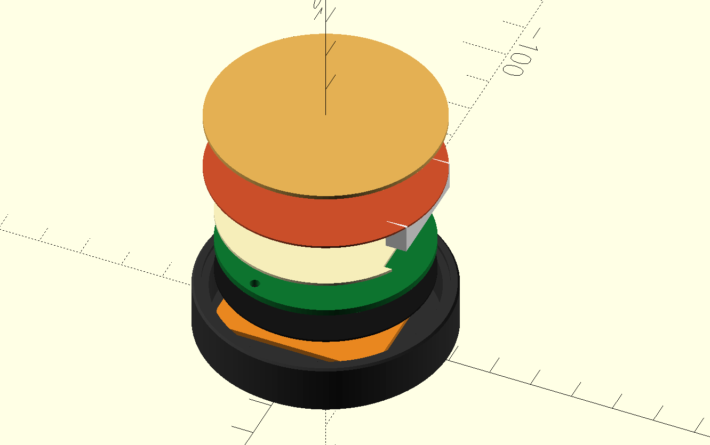
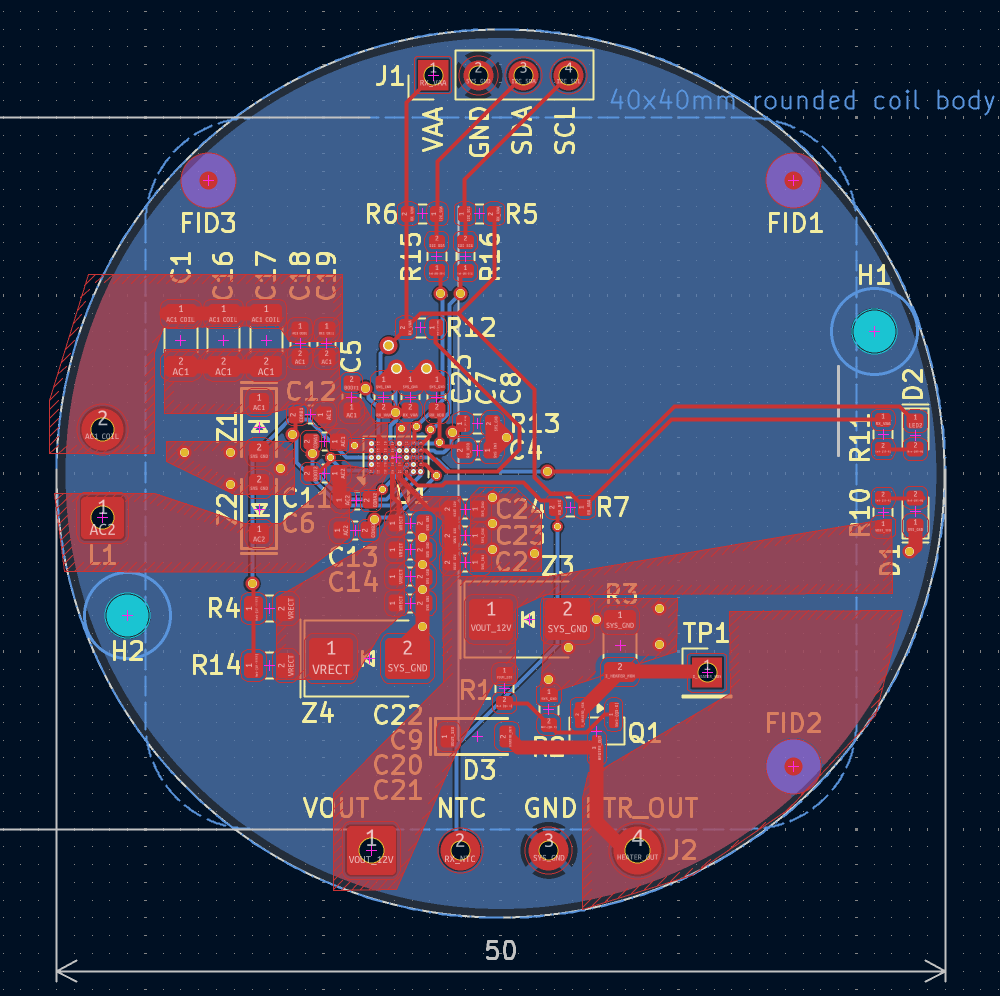
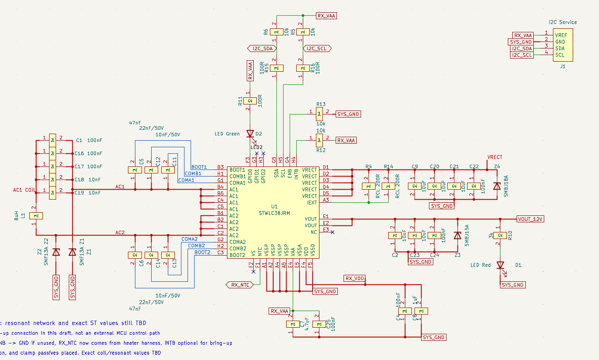
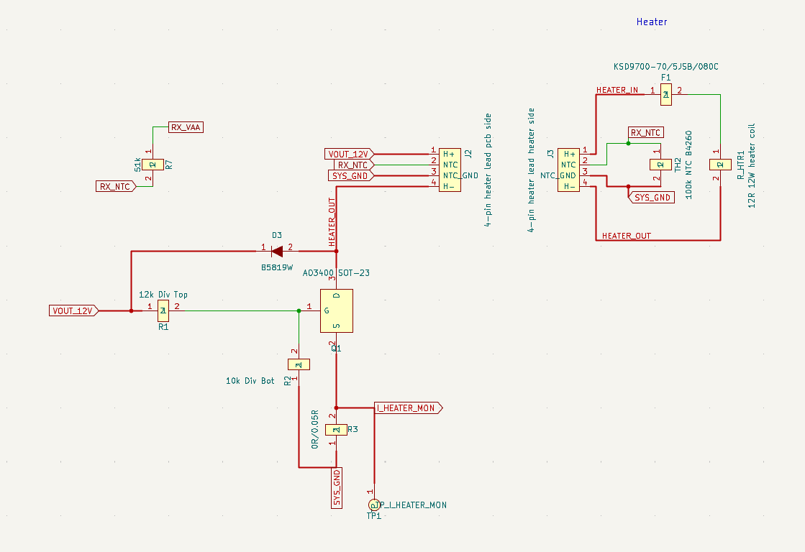

# cupwarmer

Qi ワイヤレス給電で飲み物を温かく保つ、カップウォーマーの自作プロジェクトです。カップの下に置く小さなデバイスに、Qi 受電回路・ヒーター・温度保護をまとめています。

目標は **15W 級の Qi EPP 受電と、12V・約12W のヒーター**。保温と軽い再加熱を狙って開発しています。

## 構成

| 部分 | v1 の設計 |
| --- | --- |
| Qi 受電 | STMicroelectronics STWLC38JRM。外部 MCU を使わず、IC の自律動作を利用 |
| 制御 PCB | 直径50mm、4層、厚さ1.6mm |
| ヒーター | 直径約55mm のシリコーン flexible heater。12Ω、100kΩ NTC 内蔵 |
| 温度保護 | heater 内蔵 NTC を STWLC38 の `RX_NTC` に接続。独立した70°C サーモスタット F1 をヒーターに直列接続 |
| メンテナンス | I²C service header から状態確認・NVM 設定 |
| 筐体 | 外径60mm の bottom tray。OpenSCAD で設計 |

カップ側から **cup contact pad → flexible heater → insulation → PCB → ferrite → RX coil → bottom tray** の順に重ねます。aluminum spreader は比較候補で、初回評価では省く構成です。

### 基板

### Qi 受電回路

### ヒーター回路

v1 は受電出力が有効な間、ヒーターを連続通電する設計です。PWM による温度調整は実装していません。

画像は設計の概要を示すスクリーンショットです。製作・変更時は [KiCad ソース](hardware/kicad/) と [機構ソース](hardware/mechanical/enclosure-proto.scad) を参照してください。機構図には比較候補の部材も含まれます。

## 開発状況

**動作・温度保護を評価中の試作です。**

確認済み:

- PCB とヒーターを受領。ヒーターの抵抗、NTC の温度応答、電力線とセンサー線の絶縁を確認。
- CP2112 とレベル変換基板を使った I²C 通信、STWLC38 の NVM 書き込み・読み戻しを確認。
- patch 1656 と試作設定 DA04 の保持、および電源再投入後の室温での Qi 起動を確認。

未検証:

- 実際のカップを使った加熱・保温性能と、EPP 12V での負荷動作。
- NTC の実際の遮断温度、出力停止、復帰動作。DA04 は温度保護の検証を終えた設定ではありません。
- 組み上げた状態での異物検出（FOD）、位置ずれ、空焼き時の挙動。

直近の DA04 試験はヒーター電源線を切り離した状態で行っています。12V・約12W は設計目標であり、達成済みの性能ではありません。試験条件と結果は [DA04 を含む NVM 設定の記録](hardware/test/2026-10-04-stwlc38-da01-programming.md) にまとめています。

## リポジトリの内容

| 場所 | 内容 |
| --- | --- |
| [docs/design-notes.md](docs/design-notes.md) | 設計判断と評価方針 |
| [hardware/kicad/](hardware/kicad/) | 回路図・PCB・部品ライブラリ |
| [hardware/bom/](hardware/bom/) | 部品表と実装発注用 BOM |
| [hardware/fab/](hardware/fab/) | Gerber・部品配置などの製造出力 |
| [hardware/mechanical/](hardware/mechanical/) | OpenSCAD モデル・STL・機構設計ノート |
| [hardware/firmware/stwlc38/](hardware/firmware/stwlc38/) | ST 参照ファームウェア・設定と取得元 |
| [hardware/test/](hardware/test/) | 試験記録・設定候補・I²C ツール・オフラインテスト |
| [wiki/](wiki/) | 部品・規格・参考資料の調査ノート |

詳しい機構構成は [機構設計ノート](hardware/mechanical/README.md)、NVM 書き込みの手順と制約は [STWLC38 programming](hardware/test/stwlc38-programming.md) を参照してください。
