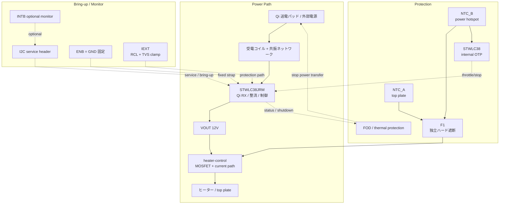

# 設計ノート

## 現在の前提

- 受電 IC は `STWLC38JRM`
- 目標は `15W` 級 Qi cup warmer
- 弱い保温専用ではなく、十分な保温と軽い再加熱の中間を狙う
- `15W` でも安全、`FOD`、位置ずれ、金属部材の影響は無視しない
- `WLCSP40` 実装は外注前提
- 初回は KiCad バイナリより先に、テキストで設計判断を固定する

## システム概要

本デバイスは高温化しうるため、温度制御とハード保護を前提にする。

```text
[カップ]
   |
[トッププレート] ← 熱伝導面（F1 を裏面に密着、温度ロガーは外付け）
[熱拡散層 / ヒーター層]
[断熱層]
[制御PCB] ← Qi 受電 + 電力制御
[heater NTC] ← H1 4線ハーネス経由で RX_NTC へ入力
[フェライトシート]
[Qi 受電コイル]
[底面シェル]
   |
[Qi EPP 15W 送電パッド]
```

## 設計方針

採用する前提:

- 目標出力は `15W` 級
- 互換性は `EPP 15W` を中心に考える
- `5W` より高いが、過剰な高出力設計には寄せない
- 温度監視、Qi 側停止、独立ハード遮断を組み合わせる

捨てる前提:

- `BQ51013B` ベースの `5W` 受電
- ヒーター直結だけで済む単純設計
- 保温用途だから軽い保護で十分という仮定
- どの Qi パッドでも同じように動くという仮定

## 現時点の主要判断

### 1. 受電 IC

`STWLC38JRM` を採用する。理由は、現行 `15W` 候補としての妥当性と、`4-12V` 可変出力、`I2C`、`FOD`、熱保護を持つ点。

受電部の要求:

- `15W` 対応受電コイル
- 共振ネットワークの再設計と実測調整
- 受電後の電力制御段
- 温度、電流、電圧の監視

### 2. 電圧方針

初回は `12V` 出力を第一候補にする。  
理由は `15W` を低電流で扱えるためで、ヒーター、MOSFET、配線損失の面で有利。

### 3. ヒーター方針

初回ヒーター目標:

- `12V`
- `12Ω`（target）
- `12W` 前後（1A）
- 初回筐体なし試作は JLCPCB silicone flexible heater。heater 内蔵 `100kΩ / B25/85≈4260K` NTC を使う

最終値は熱試験で再調整する。

### 4. 制御方針

初版では外部 `MCU` は載せない。  
`STWLC38JRM` の autonomous 動作、`I2C` service header、独立ハード保護で成立させる。

- 初版は固定 `VOUT_12V` 前提
- **v1 ヒーター gate ドライブ: 常時 ON（VOUT_12V → R1 (10k) → Q1.G、Q1.G → R2 (10k) → GND の分圧）**。VGS ≈ 6V でロジックレベル N-FET を確実に ON しつつ、`AO3400` クラス (VGS_max ±12V) でも VOUT スパイク時のマージンを確保する。Qi 給電中は連続通電。温度保護は F1 サーモスタットのみ。PWM/可変制御は v2 以降。MCU を入れる場合はゲートドライバ IC または低閾値 FET でレベル整合する。
  - Q1 候補: `AO3400` (SOT-23, RDS(ON)=28mΩ@VGS=10V, VGS_max ±12V)。I_heater = 0.8A での損失 ≈ 18mW で熱的に余裕。VGS マージンを上げたい場合は VGS ±20V 品（`DMN3404L` / `NTR4170N` 等）に置換。
- 製品固有の温調ロジックは初版のスコープ外
- `ENB` は未使用時 `GND` 固定を基本にする
- `RX_NTC` には heater 内蔵 NTC (`TH2`) を接続し、R7 (51k → RX_VAA) と分圧する。STWLC38 DS14078 Table 4 の external NTC OTP threshold は `VNTC,OTP = 0.55/0.59/0.65V` (typ 0.59V) なので、`NCP18WF104F12RB` (R25=100k, B25/85=4260K) の約69°C で threshold に到達するよう R7 を選ぶ。`TH2` は基板上 SMT 部品ではなく、JLCPCB silicone heater 注文時に heater と同じ MPN 指定で一緒に手配する外部 NTC として BOM に残す
- `INTB` は optional な bring-up / service 観測線として扱う
- `IEXT` は `RCL + TVS` の clamp path を前提にする

v2 以降または製品版で必要な制御:

- 出力デレート
- 温度上昇速度での保護
- 空焼き時の停止
- センサ断線 / 短絡時のフェイルセーフ
- `PWM` または段階的出力制御
- ソフトスタート
- 高温時の自動デレート
- カップなし時の停止または強い出力制限

### 5. 保護方針

- `NTC_A`: top plate / cup contact temperature は外部ロガーまたは将来センサで観測
- `NTC_B`: heater 内蔵 NTC (`H1` pin3/pin4 → `RX_NTC` / `SYS_GND`, IC 内蔵 OTP)
- `F1`: independent hardware cutoff。v1 は `Xucheng KSD9700-70/5JSB/080C` を第一候補にする
- `FOD`: Qi 側の停止系として扱う

Heater / F1 接続方針:

- v1 の `H1` footprint は heater power と heater NTC を同じ組立物として受ける4線大型 solder pads / wire pads として扱う
- 接続順は `VOUT_12V -> F1 -> heater -> Q1 drain`。F1 は PCB 上に寝かせず、トッププレート裏面へ密着固定する
- flexible heater、heater NTC、F1 は手実装ワイヤで接続する。v1 では board-to-wire connector や FPC/FFC connector は採用しない
- `H1` pinout は `H+`, `H-`, `NTC`, `NTC_GND`。pad は `12V`, `1A` 連続電流、手はんだ、引張緩和を前提に余裕を持たせる。connector 化は v2/量産検討

F1 採用候補（PDF: `Xucheng Elec KSD9700-70:5JSB:080C.pdf`）:

- 型番/仕様: `KSD9700-70/5JSB/080C/QG`
- 種別: 双金属片突跳式、自動復帰サーモスタット
- 接点: `SPST-NC`（常閉、温度上昇で open）
- 動作温度: `70 ±5°C`
- 復帰温度: `50 ±10°C`
- 定格: `AC250V 5A` 抵抗負荷、10,000 cycles
- 接触抵抗: `≤50mΩ`
- 絶縁抵抗: `DC500V ≥100MΩ`
- 耐圧: `AC1450V / 1min`
- リード: `1015 20AWG black wire`, `80mm`, 先端 `8mm` 予備はんだ
- 実装: トッププレート裏面に密着。JLCPCB 自動実装が難しければ基板側に接続パッド/穴だけ用意して手実装

今回のヒーター電流は `12V / 15Ω ≈ 0.8A` なので、PDF の AC 抵抗負荷定格に対して電流余裕は十分。ただし DC 定格は PDF に明記されていないため、v1 熱試験で開閉挙動と接点温度を確認する。

最低 4 層の保護として考える:

1. 接触面温度監視: 天板裏面の `NTC` / 温度センサ
2. 電力系温度監視: 受電部と電力段の近傍温度
3. Qi 側停止: 通信異常、`FOD`、出力制限時に送電停止へ移行
4. 独立遮断: ヒーター系にハード遮断を入れる

追加で検証する異常:

- カップなし時の急上昇
- センサ断線 / 短絡
- 温度上昇速度の異常
- 位置ずれや金属異物による `FOD`

## 発熱体・熱設計

`15W` は「温かい」ではなく、十分な発熱量として扱う。接触面の安全を優先して評価を始める。

初期熱目標:

- 接触面定常温度はまず `50-55°C` を起点に評価
- カップあり / なし / 金属マグで別々に検証
- 温度上昇速度も監視対象にする

ヒーター要求:

- 面内温度分布が均一
- 局所ホットスポットが出にくい
- 絶縁と接着の耐熱性が十分
- 電気的異常時に安全側へ倒れる

ヒーター候補:

- ポリイミドヒーター
- 金属箔エッチングヒーター

熱経路:

- 上方: カップへの有効熱流
- 下方: PCB と受電部への寄生熱流
- 横方向: 天板内の熱拡散

材料候補と注意点:

- アルミ天板は候補だが、Qi 結合と `FOD` への影響を再評価する
- セラミック天板も比較候補
- 断熱材は `5W` 案の流用前提にしない

## メカニカル設計

位置ずれは `15W` でも性能と `FOD` に効く。

- 底面の滑り止めを入れる
- 中心合わせしやすい外形にする
- 必要なら軽い位置決めガイドを追加する
- 外径は **φ60mm** 上限に変更（2026-05-04。実機カップ底径計測結果に合わせ φ90mm 前後の旧案から縮小）
- 高さ `7mm` は参考値
- 断熱とシールドを優先し、必要なら厚みを増やす

## Qi / FOD / 互換性

`FOD` は `15W` でも重要。次を分けて評価する。

- 金属製カップ底面
- 金属トッププレート
- 位置ずれ
- コイルからの距離増加
- ヒーター材の損失

評価で記録すること:

- どの条件で安定給電するか
- どの条件で停止するか
- どこまで位置ずれ耐性があるか

互換性の優先順:

1. `EPP 15W` 送電パッド
2. `5W BPP` パッドでのデグレード動作
3. それ以外はベストエフォート

## プロトタイピング戦略

### Phase 0: 実現性判定

1. `EPP 15W` 送電パッドを確保
2. `15W` 級受電アーキテクチャ候補を確定
3. 想定ヒーターと熱安全域を先に把握

### Phase 1: 熱単体評価

1. ベンチ電源で `15W` 相当のヒーターを駆動
2. カップあり / なし / 金属マグで評価
3. 天板温度、裏面温度、立ち上がり速度を測定

### Phase 2: 電力制御評価

1. センサ入力で出力をデレート
2. 空焼き時に安全停止できるか検証
3. ハード遮断の動作点を確認

### Phase 3: Qi 統合

1. コイル + フェライト + 制御基板 + 断熱 + ヒーターを統合
2. 位置ずれ耐性を測る
3. `FOD` 条件をマッピングする

### Phase 4: 筐体統合

1. 筐体へ組込み
2. 水滴、熱サイクル、長時間運転試験
3. 誤使用試験を追加

## 初回 PCB の考え方

- `4-layer`
- `X-ray` 前提
- `via-in-pad` などは設計前に外注 DFM で確定
- **筐体外径 φ60mm を上限**にする（2026-05-04 改定）。実機カップ底面（陶器マグ複数）を
  巻尺で測ったところ概ね `60mm` 前後のため、デバイス全体がカップ底に収まる外観を
  優先する。筐体壁厚 `1.5-2mm` 想定で、**PCB 外形は φ56mm（半径 28mm）を上限**とする。
- Qi RX コイル本体 φ35mm はフェライト + スタンドオフで PCB 上空数 mm に浮かせる。
  外周リム 10.5mm では U1 + 受動全部は収まらないため、**U1 と周辺受動はコイル直下
  （PCB 中央寄り）に配置してよい**。これは Qi RX 設計の標準レイアウトで、コイルから
  PCB までの隙間に SMT 部品高さ（0603 で 0.8mm、SMB TVS でも 2.4mm 程度）が収まる
  限り問題ない。F1/H1/L1 半田パッドはコイル外周外（リム）に置いてピグテール線を
  外に出す。
- cup contact layer と coil の距離は最小化しつつ、金属干渉は後で実測する
- カップ側は湾曲している可能性が高いため、硬い平板 top plate ではなく、曲面追従できる柔軟な thermal interface / cup contact layer を優先して評価する
- v1 第一候補はアルミナ充填シリコーンパッドにする。電気絶縁性、曲面追従、熱伝導、Qi 近傍での扱いやすさのバランスを優先する
- 比較サンプル候補:
  - 熱伝導シリコーンシート
  - グラファイトシート + 薄い絶縁フィルム

GND 方針:

- 回路図ネット名 `SYS_GND` は、基板全体で共有する system 0V を意味する。`STWLC38JRM` の `VSSP/VSSA/VSSD`、heater return、TVS return、NTC/I2C/service reference は電気的には同じ 0V 系へ接続する
- `SYS_GND` は `PGND` だけでも `AGND` だけでもないため、回路図では役割を限定しない名前にしている
- v1 では `PGND/AGND/DGND` を別ネット化せず、`SYS_GND` 一本のままにする。net-tie や plane split は、return path を切るリスクが高いため初回では使わない
- PCB では `In1.Cu` を solid GND plane とし、GND integrity と熱拡散を優先する
- `VSSP`、`CRECT/COUT`、`Z3`、heater return は power return 領域として短く太く U1 近傍へ戻す
- `VSSA`、`VAA/VDD` decoupling、`NTC`、I2C/service reference は quiet 領域として扱い、大電流 return を通さない
- `VSSP/VSSA/VSSD` の実質合流点は U1 直近の GND via cluster とし、離れた場所で一点合流を作らない

## ブロック図



- 初版は外部 `MCU` なし
- 電力の主経路は `Qi TX → coil → STWLC38JRM → VOUT_12V → heater-control → heater`
- 温度・異常時の停止は `FOD` と `F1` の二系統で受け持つ
- `I2C` / `INTB` は製品制御ではなく、bring-up / service 用の観測・設定経路として扱う
- `J1` I2C service header は `RX_VAA` 2.5V 参照の bring-up 専用口とする。v1 ではオンボード level shifter を載せず、外部 USB-I2C adapter は `VREF=RX_VAA` に追従できるものだけを使う。3.3V 固定 pull-up / 3.3V 出力の直結は禁止

## 回路図ステータス（2026-05-09 時点）

DS14078 Figure 13 / Table 36 に合わせた修正後の状態:

- `BOOT1/BOOT2` 各 `47nF` (C5/C6) → **AC1/AC2 に接続**（ブートストラップ）
- `VAA` `4.7uF` (C7) + HF bypass `100nF` (C25) + `NTC → VAA 51k` pull-up (R7)。DS14078 Table 4 の `VNTC,OTP` typ 0.59V に合わせ、heater 内蔵 `100kΩ / B25/85≈4260K` NTC で約69°C trip を狙う
- `VDD` `1uF` (C8) + HF bypass `100nF` (C4)
- `VRECT` バルク+HF: `10uF×3` (C9, C20, C21) + `100nF` HF (C22) + `SMBJ18A` TVS (Z4) — STEVAL-WLC38RX UM3154 §9.1.3 / Figure 48 を踏襲
- `VOUT` バルク+HF: `10uF×2` (C2, C23) + `100nF` HF (C24) + `SMBJ15A` TVS (Z3) — STEVAL-WLC38RX を踏襲（旧 C3 1uF は C24 100nF に置換）
- VRECT/VOUT bulk cap の耐圧判断: UM3154 §9.1.3 は VRECT cap を maximum input voltage と quick coil movement 由来の voltage peak で決め、余裕を推奨する。VOUT cap は selected output voltage で決める。v1 では VRECT 側 (C9/C20/C21) は coil movement peak と Z4 clamp 余裕を見て `10uF/35V` を維持する。VOUT 側 (C2/C23) は 12V 出力だけなら 25V でも成立するが、BOM 共通化、SMBJ15A clamp 時の短時間過渡、X5R の DC bias / 温度 derating 余裕を優先して同じ `GRM188R6YA106MA73D` (`10uF/35V`) に揃える。AC1/AC2 resonance / COM 系 cap は別扱いで、50V rating を維持する
- `IEXT` clamp: `R4 || R14 = 200R || 200R = 100R` → **VRECT** 接続（SOVP クランプ用、IEXT 内部スイッチ経由）。UM3154 / ST reference schematic は `R4,R5=200R` 並列 + `R6=NA` の構成で、cupwarmer では `R5` が I2C pull-up で使用済みのため追加分を `R14` とする。部品は JLCPCB 登録表記 `ERJP06F2000V` (`C543538`) 0805 500mW surge/thick-film を使い、クランプ電流とパルスエネルギを2本に分散する
- `AC1/AC2` ESD: `SMF13A` (Z1/Z2) 各 `GND` 直結
- `Cs` 系列共振 `100nF×3` (C1/C16/C17) + `10nF×2` (C18/C19) = 320nF。`Cd` 並列共振 C15 は Qi 認証向け後方互換用途のため v1 では削除済み
- 受電コイル: v1 は STEVAL-WLC38RX と同じ `Luxshare-ICT LD81FP008-1H` を基準にする（`8±0.2uH @100kHz`, `DCR=190mΩ±10%`, `ACR=225mΩ±10%`）
- フェライト: コイル付属/同等の backing ferrite を優先。別体 ferrite sheet は `SHIELD1 = Wuerth Elektronik WE-FSFS 364105` (60x60x0.5mm flexible sintered ferrite sheet) を第一候補にする。コイル外形に合わせてトリム/固定し、coil L/Q/DCR と FOD / 位置ずれ挙動を再測定する
- COMA/COMB ASK 変調キャパ 4 本: C11=CCOMA1(10n→AC1), C12=CCOMB1(22n→AC1), C13=CCOMA2(10n→AC2), C14=CCOMB2(22n→AC2)
- `VS` は RX-only では未使用。評価ボードでは DNP ジャンパ経由の外部 `VS` 評価点として扱われており、v1 では未接続
- `ENB` → `GND` 固定
- **`SCL/SDA` pull-up `10k` (R5/R6) → `VAA` (2.5V)**（VDD は 1.1V LDO で I2C には低すぎる。J1 経由のホスト接続は `VREF=RX_VAA` 追従または外部レベルシフタ必須。3.3V 固定 pull-up の直結は禁止）
- `VOUT` → heater-control シートへ
- ヒーター gate 分圧: R1 = 10k (VOUT_12V → Q1.G), R2 = 10k (Q1.G → GND) で VGS ≈ 6V
- F1: `KSD9700-70/5JSB/080C` を `heater-control.kicad_sch` / BOM に反映済み。トッププレート裏面に密着固定し、heater NTC と F1 open/reset の差は熱試験で確認する
- OVP TVS:
  - `Z3 = Littelfuse SMBJ15A`（VOUT_12V → cathode、anode → SYS_GND、VR=15V）。VOUT 出口近傍に配置
  - `Z4 = SMBJ18A`（VRECT → cathode、anode → SYS_GND、VR=18V）。VRECT 通常域 13–15V でリーク電流が無視できるよう VR=18V を選定し、VBR≈20V / VC=29.2V@20.55A で VRECT 35V 定格コンデンサに対して余裕を残す。U1 近傍 VRECT バルク帯に配置
- LED: D1（給電中インジ、VOUT_12V → R10(3k) → D1(red) → GND、`XL-1608SURC-04` / `C965798`）
- GPIO0 LED: D2/R11（RX_VAA → R11(1k) → D2 → GPIO0、GPIO0 は NVM 設定前提の optional indicator）

VOUT OVP 候補（PDF: `SMBJ15A.pdf`）:

- 型番: `SMBJ15A`
- 種別: unidirectional TVS diode, DO-214AA / SMB
- 用途: `VOUT_12V` の過渡過電圧を `SYS_GND` へ逃がし、Qi RX 側の OCP/FOD/停止へ持ち込む
- Peak pulse power: `600W` at `10/1000us`
- Reverse stand-off voltage `VR`: `15.0V`
- Breakdown voltage `VBR`: `16.7-18.5V` at `IT=1mA`
- Maximum clamping voltage `VC`: `24.4V` at `IPP=24.6A`
- Reverse leakage `IR`: `1uA` at `VR`
- Operating junction temperature: `-65 to 150°C`
- MSL: Level 1
- Polarity: cathode band denotes cathode

`VOUT_12V` は通常 12V なので `VR=15V` の TVS は通常動作では導通しない。異常時は 16.7V 以上で breakdown し、25V rated capacitors と 30V class MOSFET の破壊を避けるための短時間 clamp として扱う。TVS は連続過電圧を消費し続ける部品ではないため、故障時は Qi 送電側/受電側保護が停止する前提で評価する。

現行シート構成:

- `rx-power.kicad_sch`: STWLC38JRM、I2C service header、受電/保護/補助回路。`RX_NTC` は heater harness から来る外部 NTC 入力として扱う
- `heater-control.kicad_sch`: F1、Q1 low-side switch、H1 4線 heater harness、NTC pre-power DMM test pads
- `R3`: v1 通常実装は `0Ω`。評価時だけ `0.05Ω` に差し替え、R3 両端をテスター/オシロで測ってヒーター電流を推定する。`I_HEATER_MON` は bench bring-up 用の任意観測点で、製品制御には使わない

R3 / STWLC38JRM ADC 方針:

- STWLC38JRM の外部 analog input として使えるのは実質 `NTC/ADCIN2`
- `NTC/ADCIN2` は heater 内蔵 NTC (`RX_NTC`) に使うため、R3 の shunt 電圧入力には使わない
- GPIO0-2 は汎用 ADC 入力としては扱わない
- `0.05Ω` shunt は `0.8A` 時でも約 `40mV` と小さく、10-bit ADC に直接入れて製品制御するには弱い
- STWLC38JRM 内部の VOUT/OCP/FOD current measurement は I2C で参考値として見られる可能性があるが、これは R3 の外付け shunt 測定とは別物
- ヒーター電流を製品制御に使うなら、外部 current sense amplifier と MCU/ADC を追加する

現行 `heater-control.kicad_sch` には以下を反映済み:

- `H1`: 4線 heater harness。pin1 `H+`, pin2 `H-`, pin3 `NTC`, pin4 `NTC_GND`
- `TP1` / `TP2`: power-on 前に heater NTC 抵抗を DMM 確認するための test pads。これは B-only fail-safe の実装点で、能動的な NTC 未接続検出回路は載せない
- TH2 → `RX_NTC` (R7=51k と分圧、STWLC38 内蔵 OTP 入力)。70°C 時の NTC 抵抗は約15.36kΩで、理想値は `R7 = R_NTC × (2.5V / 0.59V - 1) ≈ 49.7kΩ`。51k は JLCPCB basic (`C23196`, `0603WAF5102T5E`) で、実装時の trip 目安は threshold min/typ/max で約71.8/69.3/65.8°C
- BOM 初回照合: `initial-bom.csv` は回路図 ref に合わせて heater harness, F1, TH2, Q1, R1/R2/R3/R7, LED/TVS/coil 周辺部品を反映済み。`TH2` は基板上 SMT 部品ではなく、JLCPCB silicone heater と同時注文する外部 heater NTC として BOM に残す

ERC エラー: **0 件**。残りはローカルシンボルの `lib_symbol_mismatch` 警告のみ。

## Open Items

- ~~ST 推奨の完全な最小回路~~ → rx-power に反映済み
- ~~COMA/COMB 変調キャパシタ~~ → 4 本構成で実装済み (CCOMA1/2, CCOMB1/2)
- ~~exact coil baseline~~ → v1 は `Luxshare-ICT LD81FP008-1H` + `Cs=320nF` (100nF×3 + 10nF×2) を基準にする。`Cd=3.3nF` は Qi 認証向け後方互換用途のため削除済み。ferrite と実機共振値は積層後に実測で確定
- ~~ferrite sheet baseline~~ → 別体フェライト候補は `Wuerth Elektronik WE-FSFS 364105` (60x60x0.5mm) を選定。BOM の `SHIELD1` に反映済み。コイル付属 ferrite と二重化する場合は磁気結合が変わるため、採否は組立後の L/Q/DCR、VRECT、FOD、金属マグ/カップなし停止境界で判断する
- **Cs 誘電体 3×100 nF C0G 1206 で確定 (2026-05-05)**: C1/C16/C17 (Cs primary 3×100 nF) は現状 X7R 0603 (Würth 885012206095)。cup warmer は heater H1 + コイル損失で基板常時温間動作のため、X7R の温度 ±15% + DC bias 容量減で共振ドリフト → 効率低下・VRECT 変動。C0G (NP0、±30 ppm/°C、DC bias 影響なし) が必須。サイズは小さいほど良いが、JLCPCB DB 検索の結果 **100 nF/50 V C0G は 0603・0805 ともに存在せず、1206 のみ入手可**（C0G 体積効率の物理制約）。22 nF C0G 0805 多並列で代替する案は ~14 個必要 (35 mm²) で 3×1206 (15.4 mm²) より大幅にスペース消費。AC1/AC2 differential ~42 V peak のため 50 V 維持必須 (25 V 化で 0603/0805 を狙う案は不採用)。第一候補: **Murata GRM31C5C1H104JA01L (LCSC C97946)** 100 nF 50 V C0G ±5% 1206、$0.08@100、JLC extended。C18/C19 (10 nF NP0 0603) は既に C0G なので維持。Phase 1 で sch (footprint 0603→1206) + BOM (MPN) + PCB を更新する。
- **Cd (C15) 削除 (2026-05-05)**: UM3154 §9.1.2 で「Cd は省略可、Qi 認証時の特定 TX への後方互換用途のみ」と明記。cupwarmer は Qi 認証取得しない方針なので C15 (3.3 nF NP0 / Walsin 0603N332J500CT) を sch + PCB + BOM から削除。共振点は Cd 付きの並列共振ではなく Cs 直列共振 (8 µH × 320 nF = ~99.5 kHz、`C18`/`C19` 修正前提) に依存。Cs/Cd 並列共振の変動要素が一つ減る。
- ~~heater final resistance~~ → 15Ω 採用（暫定）。熱試験で再調整
- ~~heater footprint~~ → v1 は大型 solder pads / wire pads。外部 heater/F1 series assembly を手実装し、F1 はトッププレート裏面へ密着固定する
- ~~cup contact layer material~~ → v1 第一候補はアルミナ充填シリコーンパッド。熱伝導シリコーンシート、グラファイトシート + 薄い絶縁フィルムは比較サンプルとして残す
- ~~hard cutoff implementation choice~~ → F1 は `Xucheng KSD9700-70/5JSB/080C` を第一候補に選定（open `70±5°C`, reset `50±10°C`）
- **F1 取付**: トッププレート裏面に密着させオーバーシュート抑制。手実装または機構固定を前提にする。詳細な固定候補は `hardware/mechanical/README.md`、熱試験記録は `hardware/test/thermal-test-template.md` に分離
- ~~VOUT 過電圧保護 TVS~~ → `SMBJ15A` を第一候補に選定（`VR=15V`, `VBR=16.7-18.5V`, `VC=24.4V`, `600W`）
- ~~LED-2 status indicator~~ → D2/R11 は `RX_VAA → R11(1k) → D2 → U1.F3(GPIO0)` に接続済み。`RX_INTB` は LED 駆動せず、J3 経由の bring-up / status monitor として露出する
- ~~R3 電流センス~~ → v1 通常実装は `0Ω`。評価時のみ `0.05Ω` に差し替えてベンチ測定する。STWLC38JRM には R3 を読ませない
- ~~PCB GND トポロジー~~ → 回路図は `SYS_GND` 一本、PCB は solid GND plane を維持し、`VSSP` power return と `VSSA` quiet reference を配置/配線で分離する
- ~~I2C service header 3.3V 制約~~ → v1 はオンボード level shifter なし。J1 は `RX_VAA` 2.5V VREF 追従アダプタ専用で、3.3V 固定 pull-up の直結は禁止
- ~~BOM 再生成・照合~~ → `initial-bom.csv` を現行 schematic ref と照合済み。採用品未確定の受動部品/ヘッダ/LED は `TBD` のまま管理

## 設計リスクと対策

| リスク | 深刻度 | 対策 |
|--------|--------|------|
| `15W` 受電構成の実装難度 | 中 | 受電アーキテクチャを先に絞る |
| `FOD` 誤検出 | 高 | 金属・位置ずれ・積層距離を早期評価 |
| 火傷リスク | 高 | 接触面温度制限、立ち上がり制御、独立遮断 |
| カップなし運転 | 高 | 急上昇検出と即時デレート |
| 金属製マグカップ | 高 | 実測で許容条件を決める |
| 薄型化との両立 | 中 | 断熱とシールド優先で厚みを調整 |
| 市販パッド相性 | 中 | `EPP` を中心に評価する |

## 検証方法

1. 熱設計検証: `15W` 相当ヒーターを有線で先に評価
2. 制御検証: 多点温度入力で安全停止を確認
3. Qi 統合検証: `EPP 15W` 送電側との結合安定性と `FOD` を確認
4. 安全検証: 空焼き、位置ずれ、金属マグ、無負荷を試験
5. 耐久検証: 長時間連続運転、熱サイクル、水滴試験

最初に閉じるべき事項:

- `15W` 級受電方式の選定
- `15W` 熱負荷の危険域把握
- 天板材と位置ずれ許容の確認
