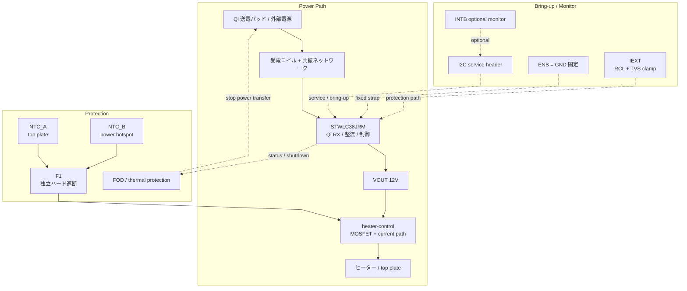

# 設計ノート

## 現在の前提

- 受電 IC は `STWLC38JRM`
- 目標は `15W` 級 Qi cup warmer
- `WLCSP40` 実装は外注前提
- 初回は KiCad バイナリより先に、テキストで設計判断を固定する

## 現時点の主要判断

### 1. 受電 IC

`STWLC38JRM` を採用する。理由は、現行 `15W` 候補としての妥当性と、`4-12V` 可変出力、`I2C`、`FOD`、熱保護を持つ点。

### 2. 電圧方針

初回は `12V` 出力を第一候補にする。  
理由は `15W` を低電流で扱えるためで、ヒーター、MOSFET、配線損失の面で有利。

### 3. ヒーター方針

初回ヒーター目標:

- `12V`
- `10Ω` 前後
- `14.4W` 前後

最終値は熱試験で再調整する。

### 4. 制御方針

初版では外部 `MCU` は載せない。  
`STWLC38JRM` の autonomous 動作、`I2C` service header、独立ハード保護で成立させる。

- 初版は固定 `VOUT_12V` 前提
- ヒーター段の gate 制御源は `TBD`
- 製品固有の温調ロジックは初版のスコープ外
- `ENB` は未使用時 `GND` 固定を基本にする
- `NTC` は専用 `RX_NTC` として露出し、未使用時は `VAA` へ `10k` pull-up とする
- `INTB` は optional な bring-up / service 観測線として扱う
- `IEXT` は `RCL + TVS` の clamp path を前提にする

### 5. 保護方針

- `NTC_A`: top plate
- `NTC_B`: power board hotspot
- `F1`: independent hardware cutoff
- `FOD`: Qi 側の停止系として扱う

## 初回 PCB の考え方

- `4-layer`
- `X-ray` 前提
- `via-in-pad` などは設計前に外注 DFM で確定
- top plate と coil の距離は最小化しつつ、金属干渉は後で実測する

## ブロック図

- 初版は外部 `MCU` なし
- 電力の主経路は `Qi TX → coil → STWLC38JRM → VOUT_12V → heater-control → heater`
- 温度・異常時の停止は `FOD` と `F1` の二系統で受け持つ
- `I2C` / `INTB` は製品制御ではなく、bring-up / service 用の観測・設定経路として扱う

## 回路図ステータス（2026-04-18 時点）

`rx-power.kicad_sch` に以下の最小外付け回路を反映済み:

- `BOOT1/BOOT2` 各 `47nF` (C5/C6)
- `VAA` `4.7uF` (C7) + `NTC → VAA 10k` pull-up (R7)
- `VDD` `1uF` (C8) + HF bypass `100nF` (C4)
- `VRECT` `10uF` (C9)
- `IEXT` clamp: `RCL 300R` (R4) + `TVS SMF13A` (TVS1)
- `ENB` → `GND` 固定
- `SCL/SDA` pull-up `10k` (R5/R6) → `VDD`
- `VOUT` → heater-control シートへ

`sensors-logic.kicad_sch` には以下を反映済み:

- `J1`: `RX_VDD` 参照付き `I2C` service header
- `TH1` / `TH2`: `10k NTC` placeholder
- `R8` / `R9`: `RX_VDD` への `10k` pull-up
- `J2`: `NTC_TOP` / `NTC_PCB` の thermal monitor header
- `J3`: `RX_INTB` / `I_HEATER_MON` の status monitor header

ERC エラー: **0 件**。残りはローカルシンボルの `lib_symbol_mismatch` 警告のみ。

## Open Items

- ~~ST 推奨の完全な最小回路~~ → rx-power に反映済み（COMA/COMB/VS は次フェーズ）
- exact coil / ferrite part（LS=8µH, CS=100nF×5 がリファレンス）
- heater final resistance and footprint
- **heater gate drive source** — GPIO (VDD ≈ 1.8V) では不足の可能性。gate driver IC or 低閾値 FET を検討
- top plate material
- hard cutoff implementation choice (F1: thermal cutoff vs thermostat)
- **COMA/COMB 変調キャパシタ** — Qi ASK 通信に必須 (10nF + 22nF)。次の symbol 拡張で対応
- **VS (復調入力)** — Qi RX 通信に必要。次の symbol 拡張で対応
