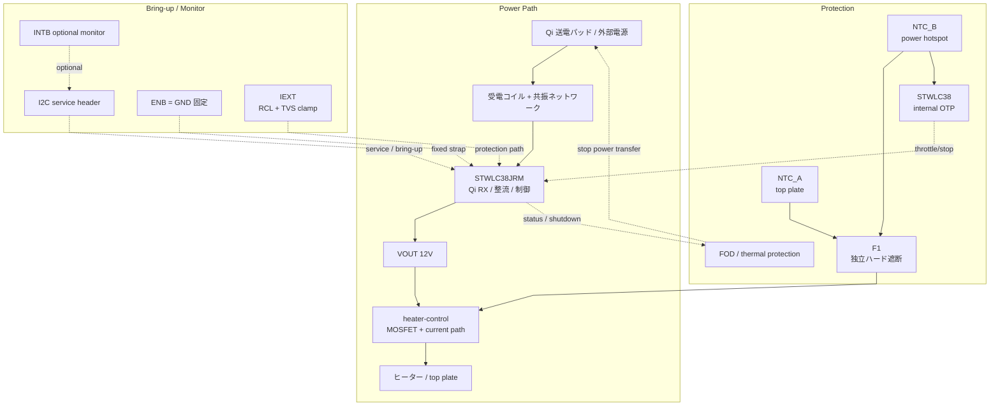

# 設計ノート

## 現在の前提

- 受電 IC は `STWLC38JRM`
- 目標は `15W` 級 Qi cup warmer
- `WLCSP40` 実装は外注前提
- 初回は KiCad バイナリより先に、テキストで設計判断を固定する

## 現時点の主要判断

### 1. 受電 IC

`STWLC38JRM` を採用する。理由は、現行 `15W` 候補としての妥当性と、`4-12V` 可変出力、`I2C`、`FOD`、熱保護を持つ点。

### 2. 電圧方針

初回は `12V` 出力を第一候補にする。  
理由は `15W` を低電流で扱えるためで、ヒーター、MOSFET、配線損失の面で有利。

### 3. ヒーター方針

初回ヒーター目標:

- `12V`
- `15Ω` 前後（2026-04-26 改定。10Ω では 14.4W となり EPP 15W × 80-85% 効率の利用可能 12-12.75W を超え、VOUT ドループ → OCP トリップの懸念）
- `9.6W` 前後

最終値は熱試験で再調整する。

### 4. 制御方針

初版では外部 `MCU` は載せない。  
`STWLC38JRM` の autonomous 動作、`I2C` service header、独立ハード保護で成立させる。

- 初版は固定 `VOUT_12V` 前提
- **v1 ヒーター gate ドライブ: 常時 ON（VOUT_12V → R1 (10k) → Q1.G、Q1.G → R2 (10k) → GND の分圧）**。VGS ≈ 6V でロジックレベル N-FET を確実に ON しつつ、`AO3400` クラス (VGS_max ±12V) でも VOUT スパイク時のマージンを確保する。Qi 給電中は連続通電。温度保護は F1 サーモスタットのみ。PWM/可変制御は v2 以降。MCU を入れる場合はゲートドライバ IC または低閾値 FET でレベル整合する。
  - Q1 候補: `AO3400` (SOT-23, RDS(ON)=28mΩ@VGS=10V, VGS_max ±12V)。I_heater = 0.8A での損失 ≈ 18mW で熱的に余裕。VGS マージンを上げたい場合は VGS ±20V 品（`DMN3404L` / `NTR4170N` 等）に置換。
- 製品固有の温調ロジックは初版のスコープ外
- `ENB` は未使用時 `GND` 固定を基本にする
- `RX_NTC` には TH2 (10k NTC, board hotspot near Qi coil) を接続し、R7 (10k → RX_VAA) と分圧する。STWLC38 内蔵 OTP がコイル/基板温度で自律的に給電を絞る/停止する。NTC を未配置にする場合は R7 のみで pull-up 終端
- `INTB` は optional な bring-up / service 観測線として扱う
- `IEXT` は `RCL + TVS` の clamp path を前提にする

### 5. 保護方針

- `NTC_A`: top plate (TH1 → J2 経由で外部観測)
- `NTC_B`: power board hotspot (TH2 → RX_NTC, IC 内蔵 OTP)
- `F1`: independent hardware cutoff
- `FOD`: Qi 側の停止系として扱う

## 初回 PCB の考え方

- `4-layer`
- `X-ray` 前提
- `via-in-pad` などは設計前に外注 DFM で確定
- top plate と coil の距離は最小化しつつ、金属干渉は後で実測する

## ブロック図

- 初版は外部 `MCU` なし
- 電力の主経路は `Qi TX → coil → STWLC38JRM → VOUT_12V → heater-control → heater`
- 温度・異常時の停止は `FOD` と `F1` の二系統で受け持つ
- `I2C` / `INTB` は製品制御ではなく、bring-up / service 用の観測・設定経路として扱う

## 回路図ステータス（2026-04-26 時点）

DS14078 Figure 13 / Table 36 に合わせた修正後の状態:

- `BOOT1/BOOT2` 各 `47nF` (C5/C6) → **AC1/AC2 に接続**（ブートストラップ）
- `VAA` `4.7uF` (C7) + `NTC → VAA 10k` pull-up (R7)
- `VDD` `1uF` (C8) + HF bypass `100nF` (C4)
- `VRECT` `10uF` (C9)
- `IEXT` clamp: `RCL 300R` (R4) → **VRECT** 接続（OVP クランプ用、IEXT 内部スイッチ経由）
- `AC1/AC2` ESD: `SMF13A` (Z1/Z2) 各 `GND` 直結
- `Cs` 系列共振 `100nF×5` (C1) + **`Cd` 並列共振 `3.3nF` (C15)**
- COMA/COMB ASK 変調キャパ 4 本: C11=CCOMA1(10n→AC1), C12=CCOMB1(22n→AC1), C13=CCOMA2(10n→AC2), C14=CCOMB2(22n→AC2)
- `VS` は RX-only では未使用。評価ボードでは DNP ジャンパ経由の外部 `VS` 評価点として扱われており、v1 では未接続
- `ENB` → `GND` 固定
- **`SCL/SDA` pull-up `10k` (R5/R6) → `VAA` (2.5V)**（VDD は 1.1V LDO で I2C には低すぎる。J1 経由のホスト接続はレベルシフタ必須）
- `VOUT` → heater-control シートへ
- ヒーター gate 分圧: R1 = 10k (VOUT_12V → Q1.G), R2 = 10k (Q1.G → GND) で VGS ≈ 6V
- LED: D1（給電中インジ、VOUT_12V → R10(3k) → D1 → GND）
- GPIO0 LED: D2/R11（RX_VAA → R11(1k) → D2 → GPIO0、GPIO0 は NVM 設定前提の optional indicator）

`sensors-logic.kicad_sch`:

- `J1`: I2C service header（VREF = VAA 2.5V）
- `TH1` / `TH2`: `10k NTC` placeholder
- `R8`: `RX_VAA` への `10k` pull-up（NTC_TOP 用）。R9 (旧 NTC_PCB pull-up) は削除
- `RX_NTC` に TH2 (NTC_B) を接続、R7 (10k → RX_VAA) と分圧。STWLC38 内蔵 OTP 入力
- `J2`: `NTC_TOP` / `RX_NTC` thermal monitor header
- `J3`: `RX_INTB` / `I_HEATER_MON` status monitor header

`sensors-logic.kicad_sch` には以下を反映済み:

- `J1`: `RX_VAA` 2.5V 参照付き `I2C` service header
- `TH1` / `TH2`: `10k NTC` placeholder
- `R8`: `RX_VAA` への `10k` pull-up（NTC_TOP 用）。R9 (旧 NTC_PCB pull-up) は削除
- TH2 → `RX_NTC` (R7 と分圧、STWLC38 内蔵 OTP 入力)
- `J2`: `NTC_TOP` / `RX_NTC` の thermal monitor header
- `J3`: `RX_INTB` / `I_HEATER_MON` の status monitor header

ERC エラー: **0 件**。残りはローカルシンボルの `lib_symbol_mismatch` 警告のみ。

## Open Items

- ~~ST 推奨の完全な最小回路~~ → rx-power に反映済み
- ~~COMA/COMB 変調キャパシタ~~ → 4 本構成で実装済み (CCOMA1/2, CCOMB1/2)
- exact coil / ferrite part（LS=8µH, CS=100nF×5, CD=3.3nF がリファレンス。実機共振値は実測で確定）
- ~~heater final resistance~~ → 15Ω 採用（暫定）。熱試験で再調整
- heater footprint
- top plate material
- hard cutoff implementation choice — F1 サーモスタットは現状 90°C TBD。**75°C 以下品への変更検討（IEC 60335 観点）**
- **F1 取付**: トッププレート裏面に密着させオーバーシュート抑制
- VOUT 過電圧保護 TVS（SMBJ15A 等）の追加検討
- LED-2（INTB ステータス）— INTB は max 3.6V かつ open-drain のため、12V LED 駆動には NPN/MOSFET バッファが必要。v1 では J3 経由の外部観測のみ。v2 で実装検討
- R3 (0.05Ω 電流センス) — ADC なしでは未使用。v1 では DNP + 0Ω ジャンパ運用
