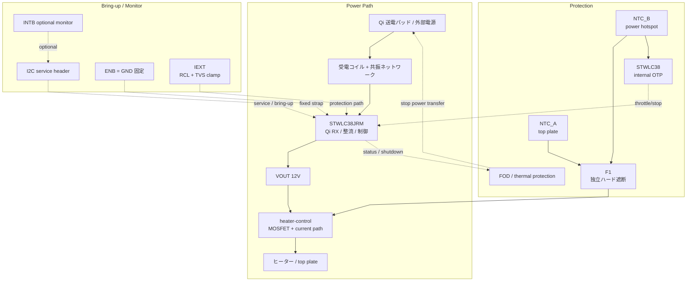

# 設計ノート

## 現在の前提

- 受電 IC は `STWLC38JRM`
- 目標は `15W` 級 Qi cup warmer
- 弱い保温専用ではなく、十分な保温と軽い再加熱の中間を狙う
- `15W` でも安全、`FOD`、位置ずれ、金属部材の影響は無視しない
- `WLCSP40` 実装は外注前提
- 初回は KiCad バイナリより先に、テキストで設計判断を固定する

## システム概要

本デバイスは高温化しうるため、温度制御とハード保護を前提にする。

```text
[カップ]
   |
[トッププレート] ← 熱伝導面（F1 を裏面に密着、温度ロガーは外付け）
[熱拡散層 / ヒーター層]
[断熱層]
[制御PCB] ← Qi 受電 + 電力制御
[heater NTC] ← H1 4線ハーネス経由で RX_NTC へ入力
[フェライトシート]
[Qi 受電コイル]
[底面シェル]
   |
[Qi EPP 15W 送電パッド]
```

## 設計方針

採用する前提:

- 目標出力は `15W` 級
- 互換性は `EPP 15W` を中心に考える
- `5W` より高いが、過剰な高出力設計には寄せない
- 温度監視、Qi 側停止、独立ハード遮断を組み合わせる

捨てる前提:

- `BQ51013B` ベースの `5W` 受電
- ヒーター直結だけで済む単純設計
- 保温用途だから軽い保護で十分という仮定
- どの Qi パッドでも同じように動くという仮定

## 現時点の主要判断

### 1. 受電 IC

`STWLC38JRM` を採用する。理由は、現行 `15W` 候補としての妥当性と、`4-12V` 可変出力、`I2C`、`FOD`、熱保護を持つ点。

受電部の要求:

- `15W` 対応受電コイル
- 共振ネットワークの再設計と実測調整
- 受電後の電力制御段
- 温度、電流、電圧の監視

### 2. 電圧方針

初回は `12V` 出力を第一候補にする。  
理由は `15W` を低電流で扱えるためで、ヒーター、MOSFET、配線損失の面で有利。

### 3. ヒーター方針

初回ヒーター目標:

- `12V`
- `12Ω`（target）
- `12W` 前後（1A）
- 初回筐体なし試作は JLCPCB silicone flexible heater。heater 内蔵 `100kΩ / B25/85≈4260K` NTC を使う

最終値は熱試験で再調整する。

### 4. 制御方針

初版では外部 `MCU` は載せない。  
`STWLC38JRM` の autonomous 動作、`I2C` service header、独立ハード保護で成立させる。

- 初版は固定 `VOUT_12V` 前提
- **v1 ヒーター gate ドライブ: 常時 ON（VOUT_12V → R1 (12k) → Q1.G、Q1.G → R2 (10k) → GND の分圧）**。VGS ≈ 5.45V でロジックレベル N-FET を ON し、SMBJ15A clamp worst-ish `VC ≈ 24.4V` 時も VGS ≈ 11.09V に抑えて `AO3400` class (VGS_max ±12V) の余裕を確保する (マージン 0.91V)。Qi 給電中は連続通電。温度保護は F1 サーモスタットのみ。PWM/可変制御は v2 以降。MCU を入れる場合はゲートドライバ IC または低閾値 FET でレベル整合する。
  - **D3 (B5819W, SOD-123) flyback / freewheel ダイオード**: anode=`HEATER_OUT` (Q1.drain = H1.pin4)、cathode=`VOUT_12V` (H1.pin1)。Q1 OFF 遷移時、ヒーターハーネスの寄生インダクタンスが Q1.drain を VOUT より上に押し上げるため、その電流を VOUT bulk (C2 / C23 / C24) へ還流させて Q1.drain の VDS スパイクを `VOUT_12V + Vf` (約 12.6V) にクランプする。AO3400 の VDS_max=30V に対して安全側。通常 ON 時は VOUT > HEATER_OUT で逆バイアス、漏れ電流のみ。Schottky を採用するのは Vf 低減と高速回復のため。1A 級 Schottky で v1 ヒーター 1A 連続 + 寄生インダクタによる短時間サージを吸収する。
  - R3 bring-up shunt を `0.05Ω` に差し替えた場合、Q1 source は `I_HEATER × 0.05Ω` だけ浮くため、実効 `VGS = VOUT_12V × 10k / (12k + 10k) - I_HEATER × 0.05Ω`。12V 入力では `5.45V - I_HEATER × 0.05Ω` なので、0.8A で約5.41V、1A で約5.40V。
  - **bring-up shunt 評価時の電流上限は 1.5A (短時間)、連続は 1.0A まで**。理由: SOT-23 Q1 (AO3400) は θJA ≈ 250°C/W、RDS(on) max 33mΩ × I² で発熱、また R3 (0603, 1/10W) のパルス耐量も 1A 強で頭打ち。**5A 級評価は禁止** (Q1 で 825mW、R3 で 1.25W に達し SOA 超過、確実に破壊)。高電流評価が必要な場合は外付け shunt + bench supply current limit で行うこと。
  - Q1 候補: `AO3400` (SOT-23, RDS(ON)=28mΩ@VGS=10V, VGS_max ±12V)。I_heater = 0.8A での損失 ≈ 18mW で熱的に余裕。VGS マージンを上げたい場合は VGS ±20V 品（`DMN3404L` / `NTR4170N` 等）に置換。
- 製品固有の温調ロジックは初版のスコープ外
- `ENB` は未使用時 `GND` 固定を基本にする
- `RX_NTC` には heater 内蔵 NTC (`TH2`) を接続し、R7 (51k → RX_VAA) と分圧する。STWLC38 DS14078 Table 4 の external NTC OTP threshold は `VNTC,OTP = 0.55/0.59/0.65V` (typ 0.59V) なので、`NCP18WF104F12RB` (R25=100k, B25/85=4260K) の約69°C で threshold に到達するよう R7 を選ぶ。DS14078 §10.4 の意図に合わせ、この入力は基板温度ではなく coil / ferrite / top plate / heater stack の過熱保護として扱う。`TH2` は基板上 SMT 部品ではなく、JLCPCB silicone heater 注文時に heater と同じ MPN 指定で一緒に手配する外部 NTC として BOM に残す
- `INTB` は optional な bring-up / service 観測線として扱う
- `IEXT` は `RCL + TVS` の clamp path を前提にする

v2 以降または製品版で必要な制御:

- 出力デレート
- 温度上昇速度での保護
- 空焼き時の停止
- センサ断線 / 短絡時のフェイルセーフ
- `PWM` または段階的出力制御
- ソフトスタート
- 高温時の自動デレート
- カップなし時の停止または強い出力制限

### 5. 保護方針

- `NTC_A`: top plate / cup contact temperature は外部ロガーまたは将来センサで観測
- `NTC_B`: heater 内蔵 NTC (`H1` pin2/pin3 → `RX_NTC` / `SYS_GND`, IC 内蔵 OTP)。board 温度センサではなく、coil / ferrite / top plate / heater stack の hotspot を STWLC38 側へ伝える保護入力として扱う
- `F1`: independent hardware cutoff。v1 は手はんだ可能なリード品 `Xucheng Elec KSD9700-70/5JSB/080C` (`LCSC C156512`) を採用（低背 SMD 候補は JLC 工程で溶接必須のため不採用、下記参照）
- `FOD`: Qi 側の停止系として扱う

Heater / F1 接続方針:

- v1 の `H1` footprint は heater power と heater NTC を同じ組立物として受ける4線大型 solder pads / wire pads として扱う
- 接続順は `VOUT_12V -> F1 -> heater -> Q1 drain`。F1 は PCB 上に寝かせず、トッププレート裏面へ密着固定する
- PCB 側には Q1 の近傍に **D3 (B5819W Schottky, SOD-123)** を flyback 還流ダイオードとして実装する。anode = `HEATER_OUT` (Q1.drain / H1.pin4)、cathode = `VOUT_12V` (H1.pin1)。Q1 OFF 時にハーネス寄生インダクタンスによる drain サージを VOUT へ還流させ、Q1 VDS を保護する
- **F1 は heater アセンブリ側に実装する**。すなわち PCB 上には F1 用フットプリントを置かず、heater ピグテール (H+ 側) の途中に F1 を直列実装してからユーザーが H1.pin1 に半田付けする運用とする。PCB の H1.pin1 ネット名は VOUT_12V のままだが、heater 組立物 (heater + TH2 + F1) を一体として扱うことで Layer-4 独立ハード遮断を担保する。組立手順書とハーネス BOM に F1 の挿入位置 (heater H+ リード途中) を明記すること
- flexible heater、heater NTC、F1 は手実装ワイヤで接続する。v1 では board-to-wire connector や FPC/FFC connector は採用しない
- `H1` pinout は pin1 `H+`, pin2 `NTC`, pin3 `NTC_GND`, pin4 `H-`。footprint は `SolderWire-HeaterHarness_1x04_P5.0mm_D1.4mm` とし、5.0 mm pitch、heater power pads は drill 1.4 mm、NTC pads は drill 1.0 mm。pad は `12V`, `1A` 連続電流、手はんだ、引張緩和を前提に余裕を持たせる。connector 化は v2/量産検討

F1 採用品（PDF: `wiki/raw/assets/xc-ksd9700-70-c156512.pdf` / datasheet 要約 `wiki/source-ksd9700-datasheet.md`）:

- 型番/仕様: `Xucheng Elec KSD9700-70/5JSB/080C` (`LCSC C156512`)
- 種別: leaded bimetal thermostat（金属缶・自己復帰 NC）
- 動作温度: `70 ±5°C`
- 復帰温度: `50 ±10°C`
- 定格: `AC250V / 5A`、`DC12V / 12A`、`DC24V / 10A`
- 接触抵抗: `≤50mΩ`
- body: `φ8.9 × 28mm` 金属缶 + `80mm` 浸錫ワイヤリード（先端 8mm 浸錫）。手はんだ可
- 認証: `CQC08002022252` / UL / TÜV / EN60730-2-9 / GB14536
- 実装: heater hotspot へ密着、H+ リード直列。トッププレート裏面 / heater assembly 側に実装し PCB には載せない

> **F1 部品変更 (2026-06-15)**: 低背化のため一旦 SMD の `Bourns NR72CB0` (`C183007`) を第一候補にしたが、JLCPCB flexible-heater 工程では `NR72CB0` も同等品 `SA77SB0` (`C143808`) も **laser welding 必須・手はんだ不可**（データシートで solder 禁止）と判明。手はんだ可能で 70°C 帯・自己復帰のリード品は JLC 在庫では `KSD9700-70` が事実上最小のため、当初部品である `KSD9700-70/5JSB/080C` (`C156512`) に戻した。代償は低背性で、`φ8.9 × 28mm` 缶は heater 下面の薄いスタックに収まらない → enclosure 側で逃げを作るか F1 を harness 側へ寄せる（Open Items 参照）。

今回のヒーター電流は `12V / 12Ω = 1A` 想定なので、`KSD9700-70` の `DC12V / 12A` 定格・`AC250V / 5A` に対して電圧・電流とも余裕が大きい（SMD 代替品にあった 9V contact rating の懸念も無い）。trip 後は機械接点が完全 open する自己復帰型で、`50 ±10°C` まで冷えると復帰する。v1 熱試験では trip/reset 温度、接点温度、再投入挙動を確認する。

最低 4 層の保護として考える:

1. 接触面温度監視: 天板裏面の `NTC` / 温度センサ
2. 電力系温度監視: 受電部と電力段の近傍温度
3. Qi 側停止: 通信異常、`FOD`、出力制限時に送電停止へ移行
4. 独立遮断: ヒーター系にハード遮断を入れる

追加で検証する異常:

- カップなし時の急上昇
- センサ断線 / 短絡
- 温度上昇速度の異常
- 位置ずれや金属異物による `FOD`

## 発熱体・熱設計

`15W` は「温かい」ではなく、十分な発熱量として扱う。接触面の安全を優先して評価を始める。

初期熱目標:

- 接触面定常温度はまず `50-55°C` を起点に評価
- カップあり / なし / 金属マグで別々に検証
- 温度上昇速度も監視対象にする

ヒーター要求:

- 面内温度分布が均一
- 局所ホットスポットが出にくい
- 絶縁と接着の耐熱性が十分
- 電気的異常時に安全側へ倒れる

ヒーター候補:

- ポリイミドヒーター
- 金属箔エッチングヒーター

熱経路:

- 上方: カップへの有効熱流
- 下方: PCB と受電部への寄生熱流
- 横方向: 天板内の熱拡散

材料候補と注意点:

- アルミ天板は候補だが、Qi 結合と `FOD` への影響を再評価する
- セラミック天板も比較候補
- 断熱材は `5W` 案の流用前提にしない

### フレキシブルヒーター (外部発注品)

ヒーターは PCB ではなく JLCPCB フレキシブルヒーターサービスで別発注する外部部品。KiCad で生成した Gerber は外形・引き出しパッド・NTC 位置だけを定義し、発熱パターンは JLCPCB に engineering review で引いてもらう。Gerber パッケージは `hardware/fab/heater/`（zip: `heater-jlcpcb-flex-heater.zip`、個別 gerber は `gerbers/`）。

仕様と意図:

- **外形 Ø55mm**: 熱スタック（aluminum spreader Ø54.5mm、heater seat Ø50.7/Ø57.2mm）に合わせたサイズで、Ø50mm の制御 PCB 基準ではない。spreader を覆い、bottom-tray の heater-seat 段に座り、Ø56.5mm の cup contact pad の下に収まる
- 電気仕様: `12V` / 約 `12W` / nominal `12Ω`
- 発熱素子材料の第一候補: FeCrAl 0.05mm（JLCPCB 側で nominal 12Ω に合わせ調整）
- 底面引き出しパッド 4 つ: `H+`, `NTC`, `NTC_GND`, `H-`
- 中心 NTC マーカー: board 中央付近の `NTC`

JLCPCB 発注ノート:

- 通常 FR-4 PCB ではなく flexible heater サービスを選ぶ
- 発熱パターンの routing を JLCPCB に依頼する（アップロード Gerber は Ø55mm 円形・底面引き出しパッド位置・中心 NTC 位置のみ定義）
- 発熱素子は FeCrAl 0.05mm で製造、または engineering review で routing/材料を調整して 12Ω に合わせる
- 内蔵 100k NTC（B25/85 約 4260K）を中心 `NTC` マーカー位置に埋め込み依頼（可能なら）
- ケーブルは底面 lead-pad エリアから引き出す。cupwarmer PCB harness は `H+`, `H-`, `NTC`, `NTC_GND` を個別線として期待する
- Gerber 寸法は JLCPCB 上で 55mm × 55mm として自動検出されるはず

#### v1 engineering review の結果 (2026-06-15, FH2026061328500004)

JLCPCB heater 部門から 4 点の指摘があり、以下で合意して製造に入った。v2 の Gerber / 図面にはこれらを最初から織り込む。

- **F1 (サーマルスイッチ) の実装位置**: 図面に指定がなかったため追記が必要だった。回答は「NTC 近傍・中央、NTC と同一面」
- **NTC の封止方式変更**: 指定 NTC (`NCP18WF104F12RB`) は JLCPCB のシリコンパッド封止プロセスに通せない。**dot adhesive (点接着) 方式に変更**して製造。「中央ホットスポットで良好な接触を保ち、約 80°C で接着が保つこと」を条件に承諾した。熱応答と長期の接着信頼性は実機で要確認
- **サーマルスイッチの実装制約**: 当初選定品と代案 `Bourns SA77SB0` (`C143808`) はいずれもレーザー溶接必須で手はんだ不可。JLC 提案の `KSD9700-70/5JSB/080C` (`C156512`) を採用した (12V/1A・70°C trip・最低背という要求に対する JLC カタログ内の最善解)
- **ヒーターパッドの寸法調整**: シリコンヒーターパッドが相対的に大きいとの指摘。製造都合でのパッドサイズ・位置調整を許可した。実物の pad 位置は受領品で実測すること

## メカニカル設計

位置ずれは `15W` でも性能と `FOD` に効く。

- 底面の滑り止めを入れる
- 中心合わせしやすい外形にする
- 必要なら軽い位置決めガイドを追加する
- 外径は **φ60mm** 上限に変更（2026-05-04。実機カップ底径計測結果に合わせ φ90mm 前後の旧案から縮小）
- 高さ `7mm` は参考値
- 断熱とシールドを優先し、必要なら厚みを増やす

## Qi / FOD / 互換性

`FOD` は `15W` でも重要。次を分けて評価する。

- 金属製カップ底面
- 金属トッププレート
- 位置ずれ
- コイルからの距離増加
- ヒーター材の損失

評価で記録すること:

- どの条件で安定給電するか
- どの条件で停止するか
- どこまで位置ずれ耐性があるか

互換性の優先順:

1. `EPP 15W` 送電パッド
2. `5W BPP` パッドでのデグレード動作
3. それ以外はベストエフォート

## プロトタイピング戦略

### Phase 0: 実現性判定

1. `EPP 15W` 送電パッドを確保
2. `15W` 級受電アーキテクチャ候補を確定
3. 想定ヒーターと熱安全域を先に把握

### Phase 1: 熱単体評価

1. ベンチ電源で `15W` 相当のヒーターを駆動
2. カップあり / なし / 金属マグで評価
3. 天板温度、裏面温度、立ち上がり速度を測定

### Phase 2: 電力制御評価

1. センサ入力で出力をデレート
2. 空焼き時に安全停止できるか検証
3. ハード遮断の動作点を確認

### Phase 3: Qi 統合

1. コイル + フェライト + 制御基板 + 断熱 + ヒーターを統合
2. 位置ずれ耐性を測る
3. `FOD` 条件をマッピングする

### Phase 4: 筐体統合

1. 筐体へ組込み
2. 水滴、熱サイクル、長時間運転試験
3. 誤使用試験を追加

## 初回 PCB の考え方

- `4-layer`
- `X-ray` 前提
- `via-in-pad` などは設計前に外注 DFM で確定
- **筐体外径 φ60mm を上限**にする（2026-05-04 改定）。実機カップ底面（陶器マグ複数）を
  巻尺で測ったところ概ね `60mm` 前後のため、デバイス全体がカップ底に収まる外観を
  優先する。筐体壁厚 `1.5-2mm` 想定で、**PCB 外形は φ56mm（半径 28mm）を上限**とする。
- Qi RX コイル本体 φ35mm はフェライト + スタンドオフで PCB 上空数 mm に浮かせる。
  外周リム 10.5mm では U1 + 受動全部は収まらないため、**U1 と周辺受動はコイル直下
  （PCB 中央寄り）に配置してよい**。これは Qi RX 設計の標準レイアウトで、コイルから
  PCB までの隙間に SMT 部品高さ（0603 で 0.8mm、SMB TVS でも 2.4mm 程度）が収まる
  限り問題ない。F1/H1/L1 半田パッドはコイル外周外（リム）に置いてピグテール線を
  外に出す。
- **heater pigtail 引き出し方向の制約 (2026-05-17 追記)**: H1 ピグテール (H+, H-, NTC, NTC_GND の 4 線) は **PCB エッジに対して垂直に外側へ** 引き出し、PCB を回り込ませない。pigtail loop が L1 コイル磁束を切るような経路 (例: H1 から PCB エッジに沿って横方向 → 上方向 → 反対側、と PCB 周囲を半周以上巡る) は禁止。AC 1次磁束 (~100kHz, 数 mT) が pigtail loop を貫くと数 V 級の誘導電圧が乗り、Qi 送電機の FOD が金属異物として誤検出して送電停止する。組立指示書に「heater 線は H1 から最短距離で PCB 外へ出し、コイル中心側を横切らない」と明記すること。
- cup contact layer と coil の距離は最小化しつつ、金属干渉は後で実測する
- カップ側は湾曲している可能性が高いため、硬い平板 top plate ではなく、曲面追従できる柔軟な thermal interface / cup contact layer を優先して評価する
- v1 第一候補はアルミナ充填シリコーンパッドにする。電気絶縁性、曲面追従、熱伝導、Qi 近傍での扱いやすさのバランスを優先する
- 比較サンプル候補:
  - 熱伝導シリコーンシート
  - グラファイトシート + 薄い絶縁フィルム

GND 方針:

- 回路図ネット名 `SYS_GND` は、基板全体で共有する system 0V を意味する。`STWLC38JRM` の `VSSP/VSSA/VSSD`、heater return、TVS return、NTC/I2C/service reference は電気的には同じ 0V 系へ接続する
- `SYS_GND` は `PGND` だけでも `AGND` だけでもないため、回路図では役割を限定しない名前にしている
- v1 では `PGND/AGND/DGND` を別ネット化せず、`SYS_GND` 一本のままにする。net-tie や plane split は、return path を切るリスクが高いため初回では使わない
- PCB では `In1.Cu` を solid GND plane とし、GND integrity と熱拡散を優先する
- `VSSP`、`CRECT/COUT`、`Z3`、heater return は power return 領域として短く太く U1 近傍へ戻す
- `VSSA`、`VAA/VDD` decoupling、`NTC`、I2C/service reference は quiet 領域として扱い、大電流 return を通さない
- `VSSP/VSSA/VSSD` の実質合流点は U1 直近の GND via cluster とし、離れた場所で一点合流を作らない

## ブロック図



- 初版は外部 `MCU` なし
- 電力の主経路は `Qi TX → coil → STWLC38JRM → VOUT_12V → heater-control → heater`
- 温度・異常時の停止は `FOD` と `F1` の二系統で受け持つ
- `I2C` / `INTB` は製品制御ではなく、bring-up / service 用の観測・設定経路として扱う
- `J1` I2C service header は `RX_VAA` 2.5V 参照の bring-up 専用口とする。v1 ではオンボード level shifter を載せず、外部 USB-I2C adapter は `VREF=RX_VAA` に追従できるものだけを使う。3.3V 固定 pull-up / 3.3V 出力の直結は禁止

## 回路図ステータス（2026-05-09 時点）

DS14078 Figure 13 / Table 36 に合わせた修正後の状態:

- `BOOT1/BOOT2` 各 `47nF` (C5/C6) → **AC1/AC2 に接続**（ブートストラップ）
- `VAA` `4.7uF` (C7) + HF bypass `100nF` (C25) + `NTC → VAA 51k` pull-up (R7)。DS14078 Table 4 の `VNTC,OTP` typ 0.59V に合わせ、heater 内蔵 `100kΩ / B25/85≈4260K` NTC で約69°C trip を狙う
- `VDD` `1uF` (C8) + HF bypass `100nF` (C4)
- `VRECT` バルク+HF: `10uF×3` (C9, C20, C21) + `100nF` HF (C22) + `SMBJ18A` TVS (Z4) — STEVAL-WLC38RX UM3154 §9.1.3 / Figure 48 を踏襲
- `VOUT` バルク+HF: `10uF×2` (C2, C23) + `100nF` HF (C24) + `SMBJ15A` TVS (Z3) — STEVAL-WLC38RX を踏襲（旧 C3 1uF は C24 100nF に置換）
- VRECT/VOUT bulk cap の耐圧判断: UM3154 §9.1.3 は VRECT cap を maximum input voltage と quick coil movement 由来の voltage peak で決め、余裕を推奨する。VOUT cap は selected output voltage で決める。v1 では VRECT 側 (C9/C20/C21) は coil movement peak と Z4 clamp 余裕を見て `10uF/35V` を維持する。VOUT 側 (C2/C23) は 12V 出力だけなら 25V でも成立するが、BOM 共通化、SMBJ15A clamp 時の短時間過渡、X5R の DC bias / 温度 derating 余裕を優先して同じ `GRM188R6YA106MA73D` (`10uF/35V`) に揃える。AC1/AC2 resonance / COM 系 cap は別扱いで、50V rating を維持する
- `IEXT` clamp: `R4 || R14 = 200R || 200R = 100R` → **VRECT** 接続（SOVP クランプ用、IEXT 内部スイッチ経由）。UM3154 / ST reference schematic は `R4,R5=200R` 並列 + `R6=NA` の構成で、cupwarmer では `R5` が I2C pull-up で使用済みのため追加分を `R14` とする。部品は JLCPCB 登録表記 `ERJP06F2000V` (`C543538`) 0805 500mW surge/thick-film を使い、クランプ電流とパルスエネルギを2本に分散する。UM3154 §9.1.5 は IEXT 内部 switch の上限を 300 mA とするため、`RCL=100Ω` では `VRECT=30V` が switch current limit 境界。12V 出力の dynamic/static SOVP 想定 `VRECT=14-17V` では `I=140-170mA`, `Ppair=1.96-2.89W`, `P_each=0.98-1.45W`。Z4 `SMBJ18A` の 10/1000us clamp `VC=29.2V` を最悪パルス電圧として見ると `I=292mA`, `Ppair=8.53W`, `P_each=4.26W`。pulse energy は `Epair=Ppair*t`, `E_each=P_each*t` で見積もり、例として `17V, 10ms` なら pair `28.9mJ` / each `14.5mJ`、`29.2V, 10ms` なら pair `85.3mJ` / each `42.6mJ`。これは 0805 500mW の連続消費では成立しないので、SOVP は短時間パルス保護として扱い、bring-up で SOVP duty、R4/R14 表面温度、VRECT clamp waveform、TX/RX 復帰挙動を確認する。SOVP が頻発または長時間化する場合は `RCL` 増加、より高パルス定格の抵抗、SOVP threshold / firmware policy を再検討する
- `AC1/AC2` ESD: `SMF13A` (Z1/Z2) を各入力から `SYS_GND` へ個別に直結する。UM3154 §9.1.6 / DS14078 §10.4 は receiving coil 側を ESD/過電圧入口として扱い、AC1/AC2 それぞれに外付け TVS を置く前提。SMF13A は `VRWM=13V`, `VBR=14.4-15.9V`, `VC=21.5V@9.3A`, `IR<=1uA@VRWM`。bring-up ではコイル位置ずれ/高負荷/高温時に、通常 AC swing で不要導通やリーク増加がないことを確認する
- `Cs` 系列共振 `100nF×3` (C1/C16/C17) + `10nF×2` (C18/C19) = 320nF。`Cd` 並列共振 C15 は Qi 認証向け後方互換用途のため v1 では削除済み
- 受電コイル: v1 は STEVAL-WLC38RX と同じ `Luxshare-ICT LD81FP008-1H` を基準にする（`8±0.2uH @100kHz`, `DCR=190mΩ±10%`, `ACR=225mΩ±10%`）
- フェライト: コイル付属/同等の backing ferrite を優先。別体 ferrite sheet は `SHIELD1 = Wuerth Elektronik WE-FSFS 364105` (60x60x0.5mm flexible sintered ferrite sheet) を第一候補にする。コイル外形に合わせてトリム/固定し、coil L/Q/DCR と FOD / 位置ずれ挙動を再測定する
- COMA/COMB ASK 変調キャパ 4 本: C11=CCOMA1(10n→AC1), C12=CCOMB1(22n→AC1), C13=CCOMA2(10n→AC2), C14=CCOMB2(22n→AC2)。UM3154 §9.1.4 / DS14078 §10.4 の初期値として採用し、custom board では coil/gap/VRECT/load/misalignment で TX 側 ASK demod が変わるため bring-up で `VRECT`, `COMA`, `COMB`, TX coil sense/demod を低負荷/高負荷・中央/位置ずれで観測する。重い負変調、TX packet error、VRECT drop 由来の過大損失が見えた場合だけ COMA/COMB 値または STWLC38 ASK configuration を再調整する
- `VS` は RX-only では未使用。評価ボードでは DNP ジャンパ経由の外部 `VS` 評価点として扱われており、v1 では未接続
- `ENB` → `GND` 固定
- **`SCL/SDA` pull-up `10k` (R5/R6) → `VAA` (2.5V)**（VDD は 1.1V LDO で I2C には低すぎる。J1 経由のホスト接続は `VREF=RX_VAA` 追従または外部レベルシフタ必須。3.3V 固定 pull-up の直結は禁止）
- `VOUT` → heater-control シートへ
- ヒーター gate 分圧: R1 = 12k (VOUT_12V → Q1.G), R2 = 10k (Q1.G → GND) で VGS ≈ 5.45V。SMBJ15A clamp `VC ≈ 24.4V` 時は VGS ≈ 11.09V (VGS_max ±12V マージン 0.91V)。
- D3 (B5819W Schottky SOD-123): flyback / freewheel ダイオード。anode=`HEATER_OUT`, cathode=`VOUT_12V`。Q1 OFF 遷移時のヒーターハーネス寄生インダクタンス由来 drain サージを VOUT bulk へ還流させる。
- F1: `Xucheng Elec KSD9700-70/5JSB/080C` (`C156512`) を BOM に反映済み。トッププレート裏面 / heater hotspot に密着固定し、heater NTC と F1 trip/reset、再投入挙動を熱試験で確認する
- OVP TVS:
  - `Z3 = Littelfuse SMBJ15A`（VOUT_12V → cathode、anode → SYS_GND、VR=15V）。VOUT 出口近傍に配置
  - `Z4 = SMBJ18A`（VRECT → cathode、anode → SYS_GND、VR=18V）。VRECT 通常域 13–15V でリーク電流が無視できるよう VR=18V を選定し、VBR≈20V / VC=29.2V@20.55A で VRECT 35V 定格コンデンサに対して余裕を残す。U1 近傍 VRECT バルク帯に配置
- LED: D1（給電中インジ、VOUT_12V → R10(3k) → D1(red) → GND、`XL-1608SURC-04` / `C965798`）
- GPIO0 LED: D2/R11（RX_VAA → R11(100Ω) → D2 → GPIO0、GPIO0 は NVM 設定前提の optional indicator）。DS14078 / UM3154 の GPIO function `0x29` (open-drain, active low output) で GPIO0 を sink 出力として使う前提。`0x02` は input + internal pull-down であり、LED 駆動設定ではない。UM3154 は 2.5 V LDO/VAA を LED 等の低電力外部回路に使えるとし、外部取り出し上限を 20 mA とするため、D2 電流は容量上問題ない。`VDD` は 1.1 V LDO で LED に不向き、`VOUT_12V` は GPIO0 へ 12 V 系を持ち込むため採用しない。
  - **R11 値の根拠 (2026-05-17 改定: 1k → 100Ω)**: 経路は `VAA(2.5V) → R11 → D2 (red XL-1608SURC, Vf typ 1.95V@20mA, low-current では Vf ≈ 1.7–1.85V) → U1.GPIO0 (open-drain sink, VOL ≈ 0.4V@sink)`。順方向電圧マージン = `2.5 − Vf − VOL ≈ 2.5 − 1.8 − 0.4 = 0.3V`。
    - R11=1k だと I ≈ 0.3mA — XL-1608SURC のデータシート Vf 曲線がほぼ flat になる領域より下で発光が不安定、最悪 LED が消灯したまま見える。
    - R11=100Ω なら I ≈ 3mA で LED が確実に点灯し、XL-1608SURC Vf データシートの 1–5mA 領域 (~1.85V) でマージンが取れる。U1.GPIO0 sink 電流 3mA は VAA LDO の 20mA 上限内、open-drain output の sink 能力 (typ 数 mA 以上) にも余裕。
    - **訂正 (2026-07-26): GPIO0 の NVM 未設定 default は `0x02` (input + internal pull-down) ではなく `0x00` = Input, FLOATING** (DS14078 p.21 Table 11)。floating なら R11 経由の漏れ電流が引く内部 pull-down が存在しないため、「GPIO0 が不定化する」という旧記述の根拠は成立しない。これに伴い **旧 bring-up 手順「NVM 書込前は R11 を DNP する」は前提が崩れたので撤回する**。D2 は GPIO0 が sink しない限り単に点かないだけで、実害はない

VOUT OVP 候補（PDF: `SMBJ15A.pdf`）:

- 型番: `SMBJ15A`
- 種別: unidirectional TVS diode, DO-214AA / SMB
- 用途: `VOUT_12V` の過渡過電圧を `SYS_GND` へ逃がし、Qi RX 側の OCP/FOD/停止へ持ち込む
- Peak pulse power: `600W` at `10/1000us`
- Reverse stand-off voltage `VR`: `15.0V`
- Breakdown voltage `VBR`: `16.7-18.5V` at `IT=1mA`
- Maximum clamping voltage `VC`: `24.4V` at `IPP=24.6A`
- Reverse leakage `IR`: `1uA` at `VR`
- Operating junction temperature: `-65 to 150°C`
- MSL: Level 1
- Polarity: cathode band denotes cathode

`VOUT_12V` は通常 12V なので `VR=15V` の TVS は通常動作では導通しない。異常時は 16.7V 以上で breakdown し、25V rated capacitors と 30V class MOSFET の破壊を避けるための短時間 clamp として扱う。TVS は連続過電圧を消費し続ける部品ではないため、故障時は Qi 送電側/受電側保護が停止する前提で評価する。

現行シート構成:

- `rx-power.kicad_sch`: STWLC38JRM、I2C service header、受電/保護/補助回路。`RX_NTC` は heater harness から来る外部 NTC 入力として扱う
- `heater-control.kicad_sch`: F1、Q1 low-side switch、H1 4線 heater harness、NTC pre-power DMM test pads
- `R3`: v1 通常実装は `0Ω`。評価時だけ `0.05Ω` に差し替え、R3 両端をテスター/オシロで測ってヒーター電流を推定する。`I_HEATER_MON` は bench bring-up 用の任意観測点で、製品制御には使わない

R3 / STWLC38JRM ADC 方針:

- STWLC38JRM の外部 analog input として使えるのは実質 `NTC/ADCIN2`
- `NTC/ADCIN2` は heater 内蔵 NTC (`RX_NTC`) に使うため、R3 の shunt 電圧入力には使わない
- GPIO0-2 は汎用 ADC 入力としては扱わない
- `0.05Ω` shunt は `0.8A` 時でも約 `40mV` と小さく、10-bit ADC に直接入れて製品制御するには弱い
- STWLC38JRM 内部の VOUT/OCP/FOD current measurement は I2C で参考値として見られる可能性があるが、これは R3 の外付け shunt 測定とは別物
- ヒーター電流を製品制御に使うなら、外部 current sense amplifier と MCU/ADC を追加する

現行 `heater-control.kicad_sch` には以下を反映済み:

- `H1`: 4線 heater harness。pin1 `H+`, pin2 `NTC`, pin3 `NTC_GND`, pin4 `H-`
- `TP1`: power-on 前に heater NTC 抵抗を DMM 確認するための `RX_NTC` test pad。return は `H1` pin3 または `J1` pin2 の `SYS_GND` から取る。これは B-only fail-safe の実装点で、能動的な NTC 未接続検出回路は載せない
- TH2 → `RX_NTC` (R7=51k と分圧、STWLC38 内蔵 OTP 入力)。70°C 時の NTC 抵抗は約15.36kΩで、理想値は `R7 = R_NTC × (2.5V / 0.59V - 1) ≈ 49.7kΩ`。51k は JLCPCB basic (`C23196`, `0603WAF5102T5E`) で、実装時の trip 目安は threshold min/typ/max で約71.8/69.3/65.8°C
- BOM 初回照合: `bom.csv` は回路図 ref に合わせて heater harness, F1, TH2, Q1, R1/R2/R3/R7, LED/TVS/coil 周辺部品を反映済み。`TH2` は基板上 SMT 部品ではなく、JLCPCB silicone heater と同時注文する外部 heater NTC として BOM に残す。メカ部品 (`MECH-*`) も同じ `bom.csv` に統合し、JLCPCB / Seeed Fusion 発注時に SMT 形式へ抽出する

### v1 手配実績 (2026-05-17 チェックリスト作成 → 2026-07-26 実績で更新)

v1 の手配は完了済み。以下は実際に発注・受領した内容。

| 部品 | 用途 | 採用品 | 手配先 / 注文番号 | 状態 |
|---|---|---|---|---|
| 制御 PCB + SMT | Ø50mm 4層 1.6mm厚 + 実装 5枚 | `cupwarmer-hw-gerbers_Y7` | JLCPCB W2026061317320516 (SMT026061360485) | 到着済 (2026-06-22 発送)。X線検査済、指摘なし |
| `U1` | STWLC38JRM | — | JLCPCB parts 先行手配 POB0202605270340260 (5個) | PCBA で消費済 |
| heater | Ø55mm 12V/12Ω/12W | JLCPCB flexible heater | JLCPCB W2026061317360571 / FH2026061328500004 (1枚) | 到着済 (2026-06-23 発送) |
| `F1` | 独立ハード遮断 | KSD9700-70/5JSB/080C (C156512) | heater 組込として JLC が調達・実装 | heater に同梱。**単体予備なし** |
| `TH2` | heater 内蔵 NTC | Murata NCP18WF104F12RB (C71280) 指定 | heater 組込 | heater に同梱。実装 MPN は受領品で要確認 |
| `L1` | 8μH Qi RX コイル | Wuerth 760308102207 | DigiKey SO#100070575 (3個) | 到着済 (2026-07-06) |
| `SHIELD1` | 60×60×0.5mm フェライトシート | Wuerth WE-FSFS 364105 | DigiKey 同注文 (3枚) | 到着済 (2026-07-06) |
| 組立副資材 | — | Kapton テープ 10mm / 3M SRR-15 両面テープ (粗面用) | DigiKey / Amazon | 到着済 |
| `MECH-PAD1` 候補 | cup contact pad | ARCTIC TP-4 100×100mm thermal pad samples | Amazon.co.jp | 発注済 (2026-07-26)。厚みは受領品で確認し、`0.5/1.0/1.5mm` 比較候補として扱う |
| `MECH-INSUL1` 候補 | PCB-heater 間 insulation | TIHONORI 赤いシリコーン発泡シート 500×500mm 厚さ1mm | Amazon.co.jp | 発注済 (2026-07-26)。導電性/ESD品でないことを受領後テスターで確認する |
| TX パッド | bring-up 用送電側 | Anker Zolo Magnetic Wireless Charging Pad (Qi2 認証, 15W, MagSafe 互換) | Amazon.de (2026-05-06, €19.99) | 到着済 (2026-05-09)。**USB-C PD 電源アダプタは別売・未手配** |

TX パッド選定の注意 (v1 実機評価に効く):

- Qi2 **MPP** 認証パッドで**マグネットアレイ内蔵**。cupwarmer RX 側にマグネットは無いため、TX は MPP をネゴシエートできず EPP / BPP へフォールバックする想定。設計方針の EPP 15W 評価に使えるかは実測で確認する
- TX 側マグネットアレイは RX コイル直下の磁性・金属構造物になるため、結合係数と `FOD` 挙動に効く。マグネットなしの EPP パッドとの比較サンプルを 1 台用意したほうがよい
- 電源アダプタ別売。15W を引くには相応の USB-C PD 電源が要る

未発注 (bring-up・熱試験に必要):

- aluminum spreader / top plate、bottom tray・retaining ring の筐体実物 (3D プリント・CNC いずれも未発注)
- TX パッド用 USB-C PD 電源アダプタ、比較用のマグネットなし EPP TX パッド
- heater harness の線材・コネクタ
- TIM (サーマルグリス等。cup contact pad と insulation の初回サンプルは Amazon 発注済み)
- 熱電対・ベンチ電源などの計測系

### v1 初回熱スタック評価方針 (2026-07-26)

初回の機構・熱評価は、加工が必要な `aluminum spreader` を後回しにし、`cup contact pad` を `flexible heater` の上へ直接載せる最小構成から始める。

```text
[Cup]
[cup contact pad: ARCTIC TP-4 flat sheet samples]
[flexible heater]
[F1 / TH2 on heater assembly]
[insulation]
[PCB]
[ferrite]
[RX coil]
[bottom tray / temporary fixture]
```

この direct-pad 構成の目的:

- I2C bring-up、NVM 状態確認、heater 通電前の安全確認後に、最短で発熱・接触・F1/TH2 応答を観測する
- aluminum spreader 由来の `FOD` / 渦電流 / 加工ばらつきを初回試験から切り離す
- カップ底面の曲面に対し、TP-4 の厚み (`0.5mm`, `1.0mm`, `1.5mm` 候補) と軽い圧縮で接触面積がどこまで取れるかを見る
- TP-4 は薄い thermal pad sheet であり、単体で設計意図どおりの凸面 crown を作る材料ではない。初回 direct-pad 評価では、TP-4 は基本的に平面パッドとして扱い、カップ荷重と一体 rim による横方向の位置決めでカップ底へ追従させる。明確な凸面が必要なら、後続で下地形状または別成形の cup contact pad を検討する
- top feature は pad を保持する retaining lip ではなく、bottom tray と一体の低い centering rim として扱う。rim は TP-4 の下半分程度を外側から囲むだけで、TP-4 の上面にも外周にも被せない。TP-4 外周は rim 内壁に nominal side contact する寸法で切り、上から置けるようにする。実物では TP-4 の切断精度と造形公差を見て、きつすぎる場合だけ微小な逃げを追加する。初回はカップ荷重と摩擦で十分か確認し、pad の浮きやズレが問題になる場合だけ最小限の仮固定を追加する
- `L1` coil reference は Wuerth `760308102207` の公称 `40 x 40 x 1.2mm` に合っている。現行 PCB の H1/H2 mounting holes は KiCad 実データで中心基準 `(+21,-8)` / `(-21,+8)`、穴径 `2.4mm`。40mm角 coil を中央配置すると、M2 boss (`Ø5mm`) は coil envelope に約 `1.5mm`、PCB穴自体も約 `0.2mm` 入るため、bottom tray の H1/H2 screw bosses は v1 direct-pad enclosure では使わない。SCAD では PCB holes は reference として残し、bottom tray boss は default off にする
- JLCPCB の実発注詳細では制御PCB厚は `1.6mm`。OpenSCAD の `pcb_th` も 1.6mm に合わせる。KiCad の Gerber job metadata に残る `BoardThickness=1.18` は発注時のJLC選択値ではないため、筐体モデルでは実物優先で扱う
- 40mm角 coil は丸角 `r≈6mm` としても角の最大半径が約 `25.8mm` になるため、旧 lower bore `Ø50.7mm` では4角が約 `0.45mm` 干渉する。v1 direct-pad enclosure では lower stack bore を `Ø52.5mm` 相当に広げ、coil/ferrite に切り欠きを要求する `stack_retention_ribs` も default off にする
- PCB/ferrite の下面支持は細い rib ではなく、bottom tray の円形内側と RX coil の rounded-rect keepout の間にある左右2面の support shelf で行う。coil の導線はサイドから出るため、上下側には支持面を置かず、leadout と組立の逃げを残す。support shelf は bottom floor から ferrite 下面まで立ち上げ、coil footprint 内には樹脂を置かない

制約と合否:

- `aluminum spreader` なしでは heater pattern の局所発熱が cup contact pad 表面へ出やすい。top surface、F1 body、TH2/RX_NTC、coil/ferrite edge を熱電対で同時監視する
- `cup contact pad` は全面接着しない。外周保持または仮固定に留め、カップ荷重で軽く圧縮する
- カップなし通電は禁止。NVM / NTC protection / VOUT 実測が確認できるまでは heater を接続しない
- 表面温度ムラ、F1/TH2 との温度相関、カップへの熱流が悪ければ、次段で `TP-4 + aluminum spreader + flexible heater` 構成を比較する

次回発注時のルール:
- `U1` (STWLC38JRM) は JLC 無在庫。**parts 先行手配 → Private Inventory が "Complete" 表示 → PCBA 発注** の順を踏む必要がある (quote → pre-order → 入庫まで v1 では 5/25〜5/30)
- リードタイム最長のもの (通常 heater + ferrite) を先行発注する
- F1 と heater は同じ heater アセンブリ上に実装されるため、両方が揃わないと bring-up できない
- coil + ferrite は実装後の L/Q/DCR/FOD 実測で構成変更の可能性あり、予備在庫を 1.5–2 倍持っておく
- **v1 は heater・F1・TH2 が 1 台分のみで予備がない**。熱試験で焼損すると JLC heater の再手配に約 10 日 + 輸送がかかる

ERC エラー: **0 件**。残りはローカルシンボルの `lib_symbol_mismatch` 警告のみ。

## NVM 書込み前提 (2026-07-26 調査)

STWLC38 の NVM (RRAM) には **patch (FW) と configuration の 2 セクション**が入る。cupwarmer が必要とする設定はほぼ全部 `CFG` 属性レジスタで、DS14078 p.18 Table 5 が `CFG = accessible through GUI only` と定義するとおり **I2C ランタイム書込みでは持てず、NVM 書込みが必須**。

### NVM 未書込でも動くこと (config 非依存)

- 整流、POVP (VRECT>14V で low-side ON)、HOVP、TSHUT、VAA UVLO (2.0/2.1V)、IEXT SOVP スイッチ本体 (DS14078 p.11 §5.5)
- VAA 2.5V / VDD 1.1V LDO の立ち上げ (外部 20mA まで)
- 外部 NTC の**ハード比較器**しきい値 `VNTC,OTP = 0.55/0.59/0.65V`。これは DS14078 Table 4 の電気的特性であって config 値ではない
- 「デジタルコアが起きるまでは default 設定で動作し、その後 NVM の config をロードする」(UM3154)

### NVM 未書込では動かないこと (すべて `CFG`)

| 項目 | default | cupwarmer の要求 | 効かないと何が起きるか |
|---|---|---|---|
| EPP VOUT 設定 | **EPP 9V / BPP 5V** | 12V | `RX EPP VOUT SET` は CFG のみ。**12V が出ずヒーターが設計電力で回らない** |
| NTC 保護のアクション | — | enable | `RX ADC NTC EN PROT` / `EPT` / `VOUT OFF` が全部 CFG。**分圧が 69°C で当たっても VOUT を切る / EPT を送る動作が保証されない** |
| FOD 係数 | 未校正 | 校正値 | BPP/EPP の CUR THR1-5、OFFSET0-5、RSER すべて CFG。校正手順は UM3154 §9.4 |
| GPIO0 Func | `0x00` = Input, FLOATING | `0x29` | `D2` が駆動できない |
| しきい値群 | — | — | OCP 1.75A / HOVP 16V / SOVP +4V / TSHUT 115°C / `RX THRES NTC` すべて CFG |
| EPP ネゴシエーション | — | — | `RX NEG` (Extended Protocol 対応) が CFG。`RX MAX POWER` (0x00AB) のみ RW |

**安全上の含意**: B-only fail-safe は「NTC が 69°C で当たったら STWLC38 が止める」前提だが、その止める動作自体が CFG。**NVM 未書込のまま heater を接続して通電してはいけない**。

さらに UM3154 §5.7 は「patch/config がロードされていなければデバイスは通信を開始せず、したがって power transfer は成立しない」と記述する。つまり素の NVM なら継続受電自体が立たず、VRECT/VAA が立つのは ping 中の一過性ということになる。

### 出荷時 NVM 状態は不明 — 最初にこれを読む

**LCSC から来た STWLC38JRM の NVM が ST 工場で書込み済か空かは、DS / UM3154 / wiki のどこにも記述がない。** I2C が通ったら以下を読めば一発で判定できる (DS14078 p.18-19):

- `0x0006-0x0007` NVM Patch ID
- `0x000A-0x000B` Configuration ID
- `0x002C/0x002D` NVM boot / CRC / section error

### 書込み手段と、v1 基板での想定外の制約

- 経路は **I2C のみ**。ST の GUI (`STSW-WPSTUDIO`) 経由か、ホスト MCU から `.h` ヘッダを流す 2 通り (UM3154 §4.6 / §9.5)。ファイルは `.memh` (patch / config 各 1 本) または両者を束ねた `.h`。patch は ST の STWLC38 製品ページで配布。RRAM の書換寿命は 1000 回
- 書込みは **DC mode** で行う。TX から離した状態で **VOUT ピンに 3V 超 (推奨 5V) の外部 DC を印加**する (UM3154 §4.6、DS14078 p.11 §5.7)
- **`J1` は 4 ピン (`RX_VAA` / `SYS_GND` / `I2C_SDA` / `I2C_SCL`) で VOUT 注入口がない**。`H1.pin1` の wire pad から入れることになる
- VOUT に 5V を掛けるとゲート分圧 `R1=12k` / `R2=10k` で `VGS ≈ 2.27V` となり AO3400 が半 ON する。**DC mode 書込みは heater 未接続で行う**こと (回路図からの推論。v2 では J1 に VOUT 注入ピンを追加するか、書込み時にゲートを落とす手当てを検討)

### ST / 実機で確認が要る点

- 新品 STWLC38JRM の出荷時 NVM 状態 (上記レジスタで実測)
- **NTC OTP の二系統問題**: DS Table 4 のハード比較器 0.59V と、DS Table 25 `RX THRES NTC` の「0-2.5V プログラマブル」が別物か同一か。cupwarmer の `R7=51k` 設計はハード側 0.59V 前提なので、**ここが config 依存だと 69°C trip 設計が崩れる**
- UM3154 Table 9 の "STWLC38 default configuration" が STEVAL ボード固有 config かチップ default か
- EPP モードで `RX BPP VOUT SET` (RW) を書いた場合に 12V が出るか (EPP 側 CFG が優先されるはずだが要実測)

## v1 bring-up ステータス (2026-07-26 時点)

- **実装済 PCB を受領し、Qi 給電で LED 点灯を確認**。基板が最低限生きている (受電して電源が立つ) ところまで到達

試験条件 (暫定・仮組み):

- TX: Anker Zolo Qi2 15W パッド
- RX: **裸の実装済 PCB をパッドに直置き**。コイル `L1` はリード線を手で剥いて基板のスルーホールに押し当てただけで、**はんだ付けなし**
- ferrite (`SHIELD1`) なし、aluminum spreader なし、heater 未接続、筐体なし

この結果から言えること / 言えないこと:

- 言える: 受電経路が生きており、整流と VAA 系が立ち上がる。極性部品が致命的に逆付けではない (JLC CPL 回転リスクの一次クリア)
- 言えない: 接触抵抗が不定、コイルの位置・向き・浮きが不定、ferrite なしで `L`/`Q` が設計値と乖離しているため、`VRECT`・効率・`FOD` の定量評価には一切使えない。共振設計 (`Cs=320nF`) の妥当性もこの試験では判定できない

未記録 (次回作業時に測って追記する):

- **点灯が連続だったか点滅だったか** — これが NVM 状態の判定に効く。UM3154 は STEVAL の D7 について「連続＝安定給電、点滅＝通信不安定/電力不足、消灯＝給電なし」と定義しており、**連続点灯なら Qi 通信が成立している＝NVM に有効な patch/config が入っている**ことになる (UM3154 §5.7 の対偶)。数秒周期のフラッシュなら TX の digital ping に同期しているだけで、NVM 未書込と整合する
- `VRECT` / `VOUT_12V` の実測値。**default が EPP 9V なので、12V が出ていれば NVM は書かれている**

点灯したのは回路構成から **`D1` でほぼ確定**:

- `D1` は `VOUT_12V → R10(3k) → D1 → SYS_GND` で `GPIO0` と無関係。VOUT が立てば点く
- `D2` は `RX_VAA → R11 → D2 → U1.F3 (GPIO0)` で、`GPIO0` が low へ sink しない限り電流が流れない。NVM 未書込時の `GPIO0` default は `0x00` (floating) なので **`D2` は原理的に点かない**
- よって今回言えるのは「VOUT LDO が立った」まで。`GPIO0` / NVM については何も言えない

未着手: コイル・ferrite の本固定、heater 接続、`RX_NTC` 分圧の DMM 確認 (`TP1`)、I2C service header (`J1`) 経由の NVM 書込、熱試験一式

ブロッカー: 筐体実物・harness 線材・TIM・PD 電源アダプタが未手配のため、スタック組立を伴う定量試験には入れない

## Open Items

- ~~ST 推奨の完全な最小回路~~ → rx-power に反映済み
- ~~COMA/COMB 変調キャパシタ~~ → 4 本構成で実装済み (CCOMA1/2, CCOMB1/2)
- ~~exact coil baseline~~ → v1 は `Luxshare-ICT LD81FP008-1H` + `Cs=320nF` (100nF×3 + 10nF×2) を基準にする。`Cd=3.3nF` は Qi 認証向け後方互換用途のため削除済み。ferrite と実機共振値は積層後に実測で確定
- ~~ferrite sheet baseline~~ → 別体フェライト候補は `Wuerth Elektronik WE-FSFS 364105` (60x60x0.5mm) を選定。BOM の `SHIELD1` に反映済み。コイル付属 ferrite と二重化する場合は磁気結合が変わるため、採否は組立後の L/Q/DCR、VRECT、FOD、金属マグ/カップなし停止境界で判断する
- **Cs 誘電体 3×100 nF C0G 1206 で確定 (2026-05-05)**: C1/C16/C17 (Cs primary 3×100 nF) は **Murata GRM31C5C1H104JA01L (LCSC C97946)**、100 nF 50 V C0G ±5% 1206 に更新済み。cup warmer は heater H1 + コイル損失で基板常時温間動作のため、X7R の温度 ±15% + DC bias 容量減で共振ドリフト → 効率低下・VRECT 変動。C0G (NP0、±30 ppm/°C、DC bias 影響なし) が必須。サイズは小さいほど良いが、JLCPCB DB 検索の結果 **100 nF/50 V C0G は 0603・0805 ともに存在せず、1206 のみ入手可**（C0G 体積効率の物理制約）。22 nF C0G 0805 多並列で代替する案は ~14 個必要 (35 mm²) で 3×1206 (15.4 mm²) より大幅にスペース消費。AC1/AC2 differential ~42 V peak のため 50 V 維持必須 (25 V 化で 0603/0805 を狙う案は不採用)。C18/C19 (10 nF NP0 0603) は既に C0G なので維持。
- **Cd (C15) 削除 (2026-05-05)**: UM3154 §9.1.2 で「Cd は省略可、Qi 認証時の特定 TX への後方互換用途のみ」と明記。cupwarmer は Qi 認証取得しない方針なので C15 (3.3 nF NP0 / Walsin 0603N332J500CT) を sch + PCB + BOM から削除。共振点は Cd 付きの並列共振ではなく Cs 直列共振 (8 µH × 320 nF = ~99.5 kHz、`C18`/`C19` 修正前提) に依存。Cs/Cd 並列共振の変動要素が一つ減る。
- ~~heater final resistance~~ → **12Ω 採用（暫定、12V/1A/12W）**。§3・heater README・`generate_heater.py` と一致。連続 1A 前提 (R3 shunt 評価上限・Q1 損失計算) と整合。熱試験で再調整
- ~~heater footprint~~ → v1 は大型 solder pads / wire pads。外部 heater/F1 series assembly を手実装し、F1 はトッププレート裏面へ密着固定する
- ~~cup contact layer material~~ → v1 第一候補はアルミナ充填シリコーンパッド。熱伝導シリコーンシート、グラファイトシート + 薄い絶縁フィルムは比較サンプルとして残す
- ~~hard cutoff implementation choice~~ → F1 は手はんだ可能なリード品 `KSD9700-70/5JSB/080C` (`C156512`) を採用（trip `70±5°C`, reset `50±10°C`, `AC250V/5A`・`DC12V/12A`）。低背 SMD 候補 (`NR72CB0`/`SA77SB0`) は JLC 工程で溶接必須のため不採用
- **F1 機械的クリアランス**: `KSD9700-70` は `φ8.9 × 28mm` 缶で従来の薄型スタック想定 (`f1_clearance_gap=1.4mm`) に収まらない。enclosure で逃げを作るか F1 を heater 中心から外して harness 側へ寄せ、hotspot 熱結合を別途確保するか要検討
- **F1 取付**: トッププレート裏面に密着させオーバーシュート抑制。手実装または機構固定を前提にする。詳細な固定候補は `hardware/mechanical/README.md`、熱試験記録は `hardware/test/thermal-test-template.md` に分離
- ~~VOUT 過電圧保護 TVS~~ → `SMBJ15A` を第一候補に選定（`VR=15V`, `VBR=16.7-18.5V`, `VC=24.4V`, `600W`）
- ~~LED-2 status indicator~~ → D2/R11 は `RX_VAA → R11(1k) → D2 → U1.F3(GPIO0)` に接続済み。`GPIO0 Func=0x29` (open-drain, active low output) の sink LED として使う。`0x02` input pull-down は LED 駆動ではない。UM3154 の 2.5 V LDO/VAA 外部低電力負荷許容 (20 mA max) に収まるため VAA のまま維持し、`VDD`/`VOUT_12V` へは移動しない。`RX_INTB` は R12 pull-up まで実装し、v1 では専用 header へは出さない。`I_HEATER_MON` は TP2 の 1-pin test point で観測する
- ~~R3 電流センス~~ → v1 通常実装は `0Ω`。評価時のみ `0.05Ω` に差し替えてベンチ測定する。STWLC38JRM には R3 を読ませない
- ~~PCB GND トポロジー~~ → 回路図は `SYS_GND` 一本、PCB は solid GND plane を維持し、`VSSP` power return と `VSSA` quiet reference を配置/配線で分離する
- ~~I2C service header 3.3V 制約~~ → v1 はオンボード level shifter なし。J1 は `RX_VAA` 2.5V VREF 追従アダプタ専用で、3.3V 固定 pull-up の直結は禁止
- ~~BOM 再生成・照合~~ → `bom.csv` を現行 schematic ref と照合済み。採用品未確定の受動部品/ヘッダ/LED は `TBD` のまま管理。メカ BOM (`MECH-*`) も同ファイルに統合

## 設計リスクと対策

| リスク | 深刻度 | 対策 |
|--------|--------|------|
| `15W` 受電構成の実装難度 | 中 | 受電アーキテクチャを先に絞る |
| `FOD` 誤検出 | 高 | 金属・位置ずれ・積層距離を早期評価 |
| 火傷リスク | 高 | 接触面温度制限、立ち上がり制御、独立遮断 |
| カップなし運転 | 高 | 急上昇検出と即時デレート |
| 金属製マグカップ | 高 | 実測で許容条件を決める |
| 薄型化との両立 | 中 | 断熱とシールド優先で厚みを調整 |
| 市販パッド相性 | 中 | `EPP` を中心に評価する |
| 極性部品の実装向き（JLC 回転ずれ） | 高 | CPL は KiCad の生エクスポート（回転補正なし）。KiCad フットプリント 0° と JLC/LCSC ライブラリ 0° のズレで、LED・ダイオード・TVS・IC 等の極性部品が 180° 逆付けになる恐れ。発注前に JLC の 3D 配置プレビューで「ガーバーのシルク・カソードバー」と「JLC 部品モデルのカソード端（−）」が同じ側にあるか必ず目視確認し、逆なら CPL の該当部品 Rotation に補正（多くは +180°）を入れる。データシートのピン定義照合だけでは判定不可（JLC の 0° 基準はテープ内向き） |

## 検証方法

1. 熱設計検証: `15W` 相当ヒーターを有線で先に評価
2. 制御検証: 多点温度入力で安全停止を確認
3. Qi 統合検証: `EPP 15W` 送電側との結合安定性と `FOD` を確認
4. 安全検証: 空焼き、位置ずれ、金属マグ、無負荷を試験
5. 耐久検証: 長時間連続運転、熱サイクル、水滴試験

最初に閉じるべき事項:

- `15W` 級受電方式の選定
- `15W` 熱負荷の危険域把握
- 天板材と位置ずれ許容の確認
